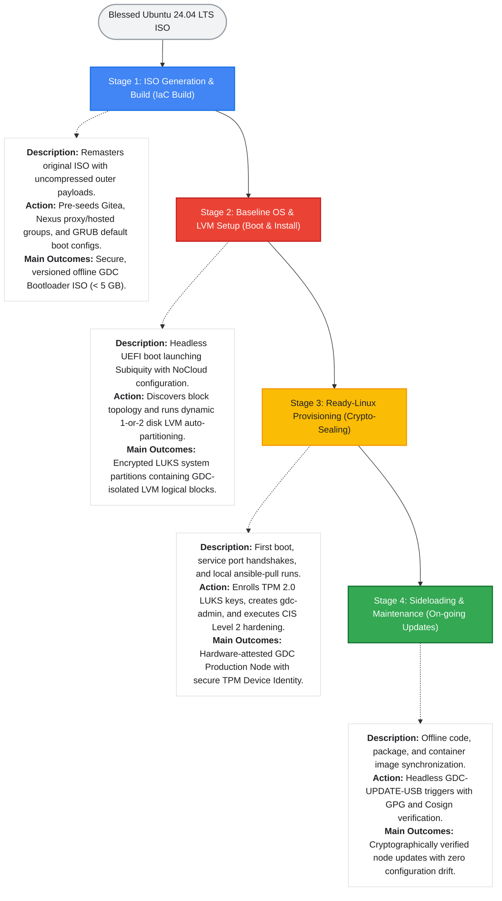

# Google Distributed Cloud (GDC) Disk Provisioner & Bootloader ISO

`gdc-disk-provisioner` contains the design, tooling, and configurations for building, provisioning, and maintaining secure, offline-first bootloader ISOs for Google Distributed Cloud (GDC) environments.

The project implements a **Hub-and-Spoke Sideloading Architecture** that enables nodes to bootstrap, configure, and receive updates completely offline in low-internet or air-gapped environments, while supporting proxy-pass-thru when internet connectivity is active.

---

## GDC Node Bootstrap Lifecycle Sequence

---

## Core Project Goals

1. **Automated Baseline Installation:** Boot from a remastered Ubuntu 24.04 LTS ISO using `subiquity` and `cloud-init` (NoCloud) to establish standard networking and partition schemes without manual intervention.
2. **GDC Bare Metal Resource Compliance:** Dynamically implement the official GDC Bare Metal enterprise LVM layout, providing isolated partitions for log buffers, metrics collection, container image stores (`containerd`), and low-latency `etcd` transactions.
3. **Local Boundary Interfaces (Gitea & Nexus Hub):** Spin up Gitea and Nexus within the booting live environment to host Ansible playbooks, local APT repositories, private Docker registries, and Hugging Face/LLM caches. These services are persistently migrated onto the target OS during installation.
4. **Seamless Offline Sideloading:** Enable operators to sideload system updates, updated playbooks, updated Docker containers, and new LLM models completely offline via physical USB bundles or localized administrative API pushing.
5. **Hardware-Backed Security:** Bind LUKS disk encryption directly to the TPM 2.0 chip, store host SSH keys securely in the TPM, register TPM-based device identity certificates, and apply CIS Benchmark Level 1/2 hardening policies.

---

## Architecture & Directory Structure

This project is organized as a spec-driven engineering effort:

*   **`docs/specs/`**: Technical specification files describing the architecture, build workflows, and configurations.
    *   `01-iso-build-pipeline.md`: The Infrastructure-as-Code (IaC) pipeline to remaster the base ISO using a reproducible `Makefile` and `xorriso`.
    *   `02-baseline-installer.md`: The Subiquity Autoinstall configuration and GDC Bare Metal enterprise LVM partition map.
    *   `03-ready-linux-provisioning.md`: The first-boot transition, local Gitea/Nexus persistence setup, local `ansible-pull` automation, TPM 2.0 configuration, CIS hardening, and the offline update/sideloading mechanics.
*   **`src/`**: Declarative playbooks, custom update utilities, and scripts.
*   **`test/`**: Verification scripts, VM-based bootstrap tests, and pre-flight validation.

---

## Storage & Partition Map

The installation process automates the following LVM partitioning scheme (isolated volume group `vg_system`), satisfying all pre-flight and performance constraints of GDC Bare Metal:

| Logical Volume | Mount Point | Size | Purpose |
| :--- | :--- | :--- | :--- |
| `lv_root` | `/` | 20 GiB | Baseline OS system binaries & core utilities |
| `lv_var` | `/var` | 20 GiB | Shared runtime directories, including `/var/lib/kubelet` |
| `lv_var_log` | `/var/log` | 15 GiB | Isolated logging (fluent-bit log buffers immune to system exhaustion) |
| `lv_var_opt_metrics` | `/var/opt/buffered-metrics` | 10 GiB | Isolated GDC metrics collector store |
| `lv_containerd` | `/var/lib/containerd` | 30 GiB | GDC local container images and volumes |
| `lv_etcd` | `/var/lib/etcd` | 20 GiB | etcd state database (latency isolated) |
| `lv_etcd_events` | `/var/lib/etcd-events` | 5 GiB | etcd events database (latency isolated) |
| `lv_gitea` | `/var/lib/gitea` | 20 GiB | Persistent Gitea git storage for localized configurations |
| `lv_nexus` | `/var/lib/nexus` | 150 GiB | Persistent Nexus repository for cached packages and LLMs |
| `lv_local_disk` | `/customer/local-disk` | 100 GiB | GDC standalone `local-disk` provisioner boundary |
| `lv_sds` | `/customer/sds` | *Remainder* | Storage boundary allocated for the custom SDS system |

---

## Offline Sideloading Workflows

Gitea and Nexus act as the local boundary endpoints for the target node. Operators can update the node entirely offline:

1.  **Code Updates (Gitea):** `git push` new playbooks directly to Gitea from a tethered administrator workstation, or insert a USB drive containing a `.bundle` update. Local cron tasks automatically trigger `ansible-pull` from the local Gitea repo.
2.  **Binary & Image Updates (Nexus):** Sideload new packages or containers using the Nexus HTTP API or a local `gdc-update` CLI tool directly from mounted USB drives.
3.  **LLM Model Syncs (Nexus Raw):** Sideload Hugging Face models directly to Nexus raw stores. Inference clients fetch locally offline by targeting `HF_ENDPOINT=http://localhost:8081/repository/gdc-llm-raw/`.
