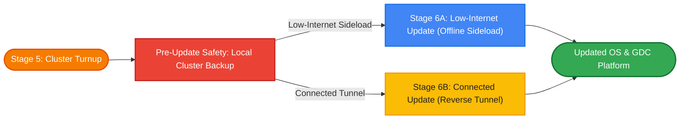
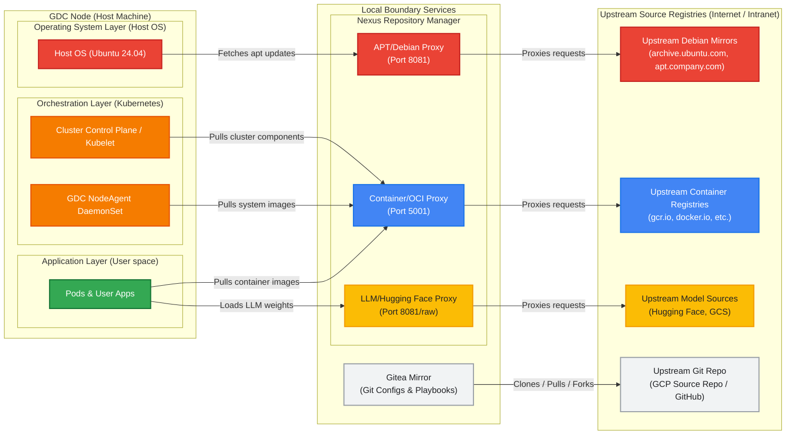

# Google Distributed Cloud (GDC) Disk Provisioner & Bootloader ISO

`gdc-disk-provisioner` contains the design, tooling, and configurations for building, provisioning, and maintaining secure, offline-first bootloader ISOs for Google Distributed Cloud (GDC) environments.

The project implements a **Hub-and-Spoke Sideloading Architecture** that enables nodes to bootstrap, configure, and receive updates completely offline in low-internet or air-gapped environments, while supporting proxy-pass-thru when internet connectivity is active.

## :alert: ALPHA STATE :alert:

NOTE: This project is in very early alpha state and should not be considered runable or usable at this current point in time.

---

## GDC Node Bootstrap & Turnup Sequence

## GDC Node Updates & Upgrades Sequence

---

## Hub-and-Spoke Sideloading & Proxy Pass-Thru Architecture

---

### Enumeration of Lifecycle Stages

#### **Stage 1: ISO Generation & Build (IaC Build)**
*   **Description:** Remasters the original provider's "blessed" ISO by injecting outer payloader directories without touching the heavy SquashFS, ensuring < 10-second compilation cycles.
*   **Action:** Downloads dependencies, pre-seeds Gitea repositories, registers Nexus proxy/hosted groups, and writes default bootloader GRUB files.
*   **Main Outcomes:** A secure, versioned, unprivileged, completely self-contained GDC Bootloader ISO (`< 5 GB`).

#### **Stage 2: Baseline OS & LVM Setup (Boot & Install)**
*   **Description:** UEFI-boots the custom GDC ISO headlessly, launching Subiquity and cloud-init under a `NoCloud` automated profile.
*   **Action:** Automatically scans host devices, executes dynamic 1-or-2 disk LVM auto-partitioning, maps an initial LUKS-encrypted container, formats LVM partitions, and copies the baseline OS image.
*   **Main Outcomes:** Encrypted baseline operating system containing isolated, GDC-compliant LVM volumes (such as containerd, log buffers, metrics space, and consensus-latencies protected etcd block storage).

#### **Stage 3: Ready-Linux Provisioning (Crypto-Sealing & Hardening)**
*   **Description:** Boots the target operating system for the first time, executing local playbooks via the automated `gdc-provision.service` and `ansible-pull` cron cycles.
*   **Action:** Performs wait-for-port service handshakes, creates `gdc-admin` with passwordless sudo, enrolls and seals LUKS disk encryption keys to the hardware TPM 2.0 chip, executes standard CIS Level 2 hardening, and pre-stages GDC NodeAgent helper files and container image layers.
*   **Main Outcomes:** Fully hardened, hardware-attested GDC Production Node with un-extractable TPM-bound identity certificates and offline-cached NodeAgent assets.

#### **Stage 4: GDC Bootstrapping (Local Dependency Integration)**
*   **Description:** Launches Gitea and Sonatype Nexus persistently to act as offline **Bootstrap Dependency Interfaces**.
*   **Action:** Serves pre-cached container image layers, playbook Git repositories, Debian package mirrors, and raw LLM weight assets locally on the host. Handles headless "Sneakernet" physical USB updates automatically utilizing custom `udev` rules and motherboard speaker status beeps.
*   **Main Outcomes:** Node is completely self-sufficient and isolated, capable of receiving offline patches and upgrades with zero network configuration drift.

#### **Stage 5: Cluster Turnup (Cluster Creation & NodeAgent Deployment)**
*   **Description:** Initiates and spawns GDC Bare Metal Kubernetes orchestrators completely offline.
*   **Action:** Executes automated cluster turnup commands (via GDC's `bmctl` tool) pulling system layers locally from the Nexus port `5001` group OCI registry, and deploys the pre-staged GDC NodeAgent onto node machines post-creation.
*   **Main Outcomes:** Active, highly secure, production-ready Google Distributed Cloud bare-metal cluster running active user workloads with the GDC NodeAgent fully operational.

#### **Stage 6A: Low-Internet Update (Offline Sideload)**
*   **Description:** An offline-first operational pathway to execute system and platform updates via localized physical media or secure regional GCS bucket caching.
*   **Action:** Downloads updated playbooks, deb packages, and OCI image layers on a connected workstation, copies them onto a physical USB drive labeled `GDC-UPDATE-USB` with a crypt-signature, and inserts it into the node. The headless `udev` daemon automatically triggers a systemd update, REST-uploading files into our local Gitea and Nexus interfaces.
*   **Main Outcomes:** Safe, cryptographically verified (GPG and Cosign) host operating system and platform upgrades with zero network configuration drift.

#### **Stage 6B: Connected Update (Reverse Tunnel)**
*   **Description:** A centralized, network-connected pathway to execute system and platform updates via secure outbound-only VPN tunnels.
*   **Action:** Establishes an encrypted, outbound-only reverse VPN tunnel (e.g. WireGuard, SSH, or GDC Tunnel) to the GCP administrative gateway. The node's local Gitea mirror uses this secure tunnel to run a `git pull` from the production `UPSTREAM_PLAYBOOKS_REPO`, automatically triggering the local `ansible-pull` cron cycles.
*   **Main Outcomes:** Centralized, automated, and secure system upgrades and playbook synchronizations.

---

## Core Project Goals

1. **Automated Baseline Installation:** Boot from a remastered Ubuntu 24.04 LTS ISO using `subiquity` and `cloud-init` (NoCloud) to establish standard networking and partition schemes without manual intervention.
2. **GDC Bare Metal Resource Compliance:** Dynamically implement the official GDC Bare Metal enterprise LVM layout, providing isolated partitions for log buffers, metrics collection, container image stores (`containerd`), and low-latency `etcd` transactions.
3. **Local Boundary Interfaces (Gitea & Nexus Hub):** Spin up Gitea and Nexus within the booting live environment to host Ansible playbooks, local APT repositories, private Docker registries, and Hugging Face/LLM caches. These services are persistently migrated onto the target OS during installation.
4. **Seamless Offline Sideloading:** Enable operators to sideload system updates, updated playbooks, updated Docker containers, and new LLM models completely offline via physical USB bundles or localized administrative API pushing.
5. **Hardware-Backed Security:** Bind LUKS disk encryption directly to the TPM 2.0 chip, store host SSH keys securely in the TPM, register TPM-based device identity certificates, and apply CIS Benchmark Level 1/2 hardening policies.

---

## Architecture & Directory Structure

This project is organized as a spec-driven engineering effort:

*   **`docs/specs/`**: Technical specification files describing the architecture, build workflows, and configurations.
    *   `01-iso-build-pipeline.md`: The Infrastructure-as-Code (IaC) pipeline to remaster the base ISO using a reproducible `Makefile` and `xorriso`.
    *   `02-baseline-installer.md`: The Subiquity Autoinstall configuration and GDC Bare Metal enterprise LVM partition map.
    *   `03-ready-linux-provisioning.md`: The first-boot transition, local Gitea/Nexus persistence setup, local `ansible-pull` automation, TPM 2.0 configuration, CIS hardening, and the offline update/sideloading mechanics.
*   **`src/`**: Declarative playbooks, custom update utilities, and scripts.
*   **`test/`**: Verification scripts, VM-based bootstrap tests, and pre-flight validation.

---

## Storage & Partition Map

The installation process automates the following LVM partitioning scheme (isolated volume group `vg_system`), satisfying all pre-flight and performance constraints of GDC Bare Metal:

| Logical Volume | Mount Point | Size | Purpose |
| :--- | :--- | :--- | :--- |
| `lv_root` | `/` | 20 GiB | Baseline OS system binaries & core utilities |
| `lv_var` | `/var` | 20 GiB | Shared runtime directories, including `/var/lib/kubelet` |
| `lv_var_log` | `/var/log` | 15 GiB | Isolated logging (fluent-bit log buffers immune to system exhaustion) |
| `lv_var_opt_metrics` | `/var/opt/buffered-metrics` | 10 GiB | Isolated GDC metrics collector store |
| `lv_containerd` | `/var/lib/containerd` | 30 GiB | GDC local container images and volumes |
| `lv_etcd` | `/var/lib/etcd` | 20 GiB | etcd state database (latency isolated) |
| `lv_etcd_events` | `/var/lib/etcd-events` | 5 GiB | etcd events database (latency isolated) |
| `lv_gitea` | `/var/lib/gitea` | 20 GiB | Persistent Gitea git storage for localized configurations |
| `lv_nexus` | `/var/lib/nexus` | 150 GiB | Persistent Nexus repository for cached packages and LLMs |
| `lv_local_disk` | `/customer/local-disk` | 100 GiB | GDC standalone `local-disk` provisioner boundary |
| `lv_sds` | `/customer/sds` | *Remainder* | Storage boundary allocated for the custom SDS system |

---

## Offline Sideloading Workflows

Gitea and Nexus act as the local boundary endpoints for the target node. Operators can update the node entirely offline:

1.  **Code Updates (Gitea):** `git push` new playbooks directly to Gitea from a tethered administrator workstation, or insert a USB drive containing a `.bundle` update. Local cron tasks automatically trigger `ansible-pull` from the local Gitea repo.
2.  **Binary & Image Updates (Nexus):** Sideload new packages or containers using the Nexus HTTP API or a local `gdc-update` CLI tool directly from mounted USB drives.
3.  **LLM Model Syncs (Nexus Raw):** Sideload Hugging Face models directly to Nexus raw stores. Inference clients fetch locally offline by targeting `HF_ENDPOINT=http://localhost:8081/repository/gdc-llm-raw/`.
