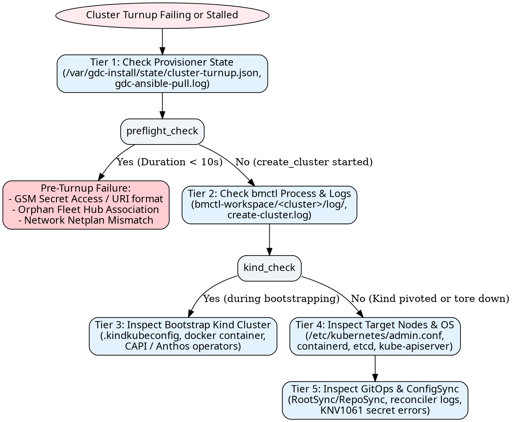

# GDC Cluster Turnup Diagnostics

## Overview

A structured diagnostic methodology for identifying why a Google Distributed Cloud (GDC) Software-Only (bare-metal) cluster installation failed, stalled, or did not turn up healthy.

GDC Cluster Turnup spans multiple distributed layers:
1. **Tier 1: Provisioner Pre-Checks & Safety Gates** (Ansible `local.yml` / `stages/stage_cluster_turnup.yml`)
2. **Tier 2: `bmctl` CLI Orchestration & Workspaces** (`create_cluster.sh` / `bmctl`)
3. **Tier 3: Ephemeral Bootstrap Cluster** (Kind Docker container `bmctl-control-plane`)
4. **Tier 4: Target Bare-Metal Node & OS Control Plane** (`/etc/kubernetes/admin.conf`, containerd, etcd)
5. **Tier 5: GitOps & ConfigSync Reconcilers** (RootSync, RepoSync, ACM, GSM secrets)

---

## Diagnostic Flowchart



---

## Tiered Investigation Procedures

### Tier 1: Provisioner Pre-Execution & Safety Gates

Before Anthos `bmctl` is even launched, `gdc-provisioner` runs deterministic safety assertions. If turnup fails in under 10 seconds, the issue is almost always in this tier.

| Artifact / Path | What to Inspect | Command / Diagnostic Technique |
| :--- | :--- | :--- |
| `/var/gdc-install/state/cluster-turnup.json` | Turnup status, duration, and error payload | `cat /var/gdc-install/state/cluster-turnup.json` |
| `/var/gdc-install/logs/gdc-ansible-pull.log` | Exact Ansible task failure and stack trace | `tail -n 100 /var/gdc-install/logs/gdc-ansible-pull.log` |
| `/etc/ansible/facts.d/gdc.fact` | Source of truth for cluster parameters, GSA, secret names, and locations | `cat /etc/ansible/facts.d/gdc.fact \| jq '.cluster, .gcp_info'` |
| Active OAuth2 Token & ADC | Validate bearer token validity and test GCP API queries directly | `export GOOGLE_APPLICATION_CREDENTIALS=/etc/gdc/application_default_credentials.json`<br>`export GOOGLE_EXTERNAL_ACCOUNT_ALLOW_EXECUTABLES=1`<br>`gcloud auth print-access-token` |
| GSM Secret Direct Test | Test secret access with and without `--location` | `gcloud secrets versions access latest --secret=<NAME> --project=<PROJ> [--location=<LOC>]` |

#### Common Tier 1 Root Causes
1. **Regional Secret vs User-Managed Global Replicated Secret:**
   * Secret created with `--replication-policy=user-managed --locations=<REGION>` is a **global** secret resource (`projects/{PROJECT}/secrets/{NAME}`).
   * Passing `--location=<REGION>` to `gcloud secrets versions access` sends the query to the regional Secret Manager endpoint, which expects `projects/{PROJECT}/locations/{REGION}/secrets/{NAME}` and fails with `INVALID_ARGUMENT`.
   * **Mitigation (Dual-Pass Fallback):** If a query with `--location` fails, immediately fallback to querying the secret globally without `--location`. Only assert failure if both calls fail.
2. **Missing IAM Permissions (`PERMISSION_DENIED`):**
   * Service Account (e.g., `sa-companion@...`) lacks `roles/secretmanager.secretAccessor`.
   * **Security Best Practice (Least Privilege):** Grant `roles/secretmanager.secretAccessor` **specifically on the required secret** rather than project-wide:
     ```bash
     gcloud secrets add-iam-policy-binding <SECRET_NAME> \
       --member="serviceAccount:<GSA_EMAIL>" \
       --role="roles/secretmanager.secretAccessor" \
       --project="<PROJECT_ID>"
     ```
     Project-level binding (`gcloud projects add-iam-policy-binding`) gives access to *all* secrets in the project, violating the Principle of Least Privilege (PoLP).
3. **Orphan Fleet Hub Registration:**
   * `local_cluster_healthy: false` but `fleet_membership_associated: true`. Occurs when a node is wiped and reinstalled without deregistering the old membership from Google Cloud Fleet Hub.

---

### Tier 2: `bmctl` CLI Orchestration & Workspace Logs

If pre-checks pass, `bin/cluster/create_cluster.sh` invokes `bmctl`.

| Artifact / Path | What to Inspect | Command / Diagnostic Technique |
| :--- | :--- | :--- |
| Active `bmctl` Process | Verify if `bmctl` or `create_cluster.sh` is running | `ps aux \| grep -E "create_cluster\|bmctl"` |
| Workspace Config File | Check rendered cluster definition (VIP, node IPs, versions) | `cat /var/gdc-install/bmctl-workspace/<cluster>/<cluster>.yaml` |
| Preflight Run Logs | Network, OS, and prerequisite failures | `tail -f /var/gdc-install/bmctl-workspace/<cluster>/log/check-preflight-*/check-preflight.log` |
| Creation Logs | Step-by-step turnup logs | `tail -f /var/gdc-install/bmctl-workspace/<cluster>/log/create-cluster-*/create-cluster.log` |

#### Common Tier 2 Root Causes
1. **Preflight Port / Interface Conflicts:** VIP or Control Plane ports (6443, 10250) already bound by rogue services.
2. **Kernel / Driver Mismatches:** Missing mandatory modules (`iscsi_tcp`, `ib_iser`) or unconfigured sysctl tuning.

---

### Tier 3: The Ephemeral Bootstrap Cluster (Kind)

During turnup, `bmctl` spins up a local Kind Docker container (`bmctl-control-plane`) to host the Cluster API (CAPI) control loop before pivoting to bare-metal nodes.

| Artifact / Path | What to Inspect | Command / Diagnostic Technique |
| :--- | :--- | :--- |
| Kind Docker Container | Ensure the container is alive and not boot-looping | `sudo docker ps \| grep kindest/node`<br>`sudo docker logs bmctl-control-plane` |
| Kind Kubeconfig | Connect directly to the ephemeral bootstrap cluster | `export KUBECONFIG=/var/gdc-install/bmctl-workspace/.kindkubeconfig`<br>`kubectl get nodes` |
| CAPI Custom Resources | Inspect provisioning status of machines and nodepools | `kubectl get baremetalclusters,clusters,machines,baremetalmachines -A`<br>`kubectl describe baremetalcluster -A` |
| Anthos Operators | Check operators running inside Kind | `kubectl get pods -n kube-system -l k8s-app=anthos-cluster-operator`<br>`kubectl logs -n kube-system deploy/anthos-cluster-operator -c operator` |
| Workload Identity Projection | Inspect the projected identity making GCP API calls | `kubectl get configmap controller-workload-identity -n kube-system -o yaml` |

#### Common Tier 3 Root Causes
1. **Workload Identity Authorization Failure:**
   * Format: `serviceAccount:<PROJECT_ID>.svc.id.goog[kube-system/anthos-cluster-operator]`
   * Must have `roles/gkehub.admin` and `roles/iam.serviceAccountTokenCreator` on Google Cloud IAM.
2. **Secret `<cluster>-kubeconfig` Not Found:**
   * CAPI controllers waiting on the bare-metal machine to respond over SSH or complete kubeadm init.

---

### Tier 4: Bare-Metal Target Node Health & Pivot

Once the bootstrap cluster hands off control, the target bare-metal node takes over as the live control plane.

| Artifact / Path | What to Inspect | Command / Diagnostic Technique |
| :--- | :--- | :--- |
| Target Admin Kubeconfig | Check target cluster health directly | `export KUBECONFIG=/etc/kubernetes/admin.conf`<br>`kubectl get nodes -o wide` |
| Core Control Plane Pods | Verify etcd, API server, and scheduler | `kubectl get pods -n kube-system` |
| Container Runtime | Ensure containerd isn't failing image pulls | `sudo systemctl status containerd`<br>`sudo journalctl -u containerd -n 50 --no-pager` |
| CNI Networking | Verify Pod CIDR and inter-node networking (Cilium/Calico) | `kubectl get daemonsets -n kube-system`<br>`kubectl logs -n kube-system -l k8s-app=cilium` |
| Storage Classes | Ensure default CSI storage classes are registered | `kubectl get storageclass` |

#### Common Tier 4 Root Causes
1. **Node NotReady:** CNI plugin not healthy or kubelet failing node lease renewals.
2. **Container Runtime Timeouts:** Docker daemon or containerd mirror configurations missing local registry mirrors.

---

### Tier 5: GitOps & ConfigSync Operational Health

Once the Kubernetes nodes are `Ready`, ConfigSync reconciles cluster state.

| Artifact / Path | What to Inspect | Command / Diagnostic Technique |
| :--- | :--- | :--- |
| Operational Audit Script | Run the built-in diagnostic tool with live ASCII table output | `sudo /usr/local/bin/cluster/check_config_sync.sh --timeout=30` |
| RootSync & RepoSync CRDs | Check sync status, commit hash, and error counts | `kubectl get rootsync,reposync -A -o wide` |
| Detailed Error Conditions | Inspect specific sync failures | `kubectl describe rootsync -n config-management-system <SYNC_NAME>` |
| Reconciler Container Logs | Check git-sync or OCI pull issues | `kubectl logs -n config-management-system deploy/root-reconciler -c git-sync`<br>`kubectl logs -n config-management-system deploy/root-reconciler -c reconciler` |
| Auth Secrets | Verify K8s secrets match RootSync `spec.git.secretRef` | `kubectl get secrets -n config-management-system` |

#### Common Tier 5 Root Causes
1. **`KNV1061: Secret not found`:** The Kubernetes secret expected by ConfigSync was not deployed.
2. **`KNV2004: Git authentication failed`:** Bad SSH key or expired Personal Access Token.
3. **`KNV1065: Rendering error`:** Malformed Kustomization or invalid YAML in the repository.
