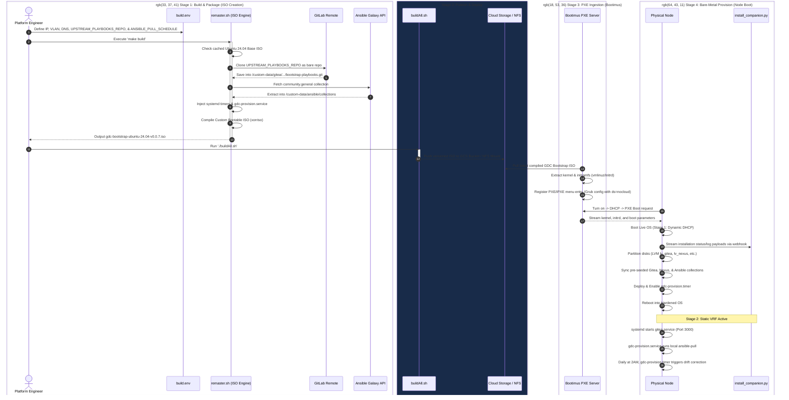

# GDC Node Provisioner - Architecture & Sequence Specification

This document details the complete end-to-end lifecycle of the Google Distributed Cloud (GDC) Bare Metal Node Provisioner pipeline. It outlines the sequence of transitions from initial variable configuration up to automated PXE-driven operating system installation, local Gitea hosting, and daily drift-correction execution via systemd timers.

---

## 1. End-to-End Sequence Diagram

The provisioning sequence is divided into four distinct stages:
1. **Stage 1 (ISO Creation):** Code and environment variables are compiled into a bootable, self-contained ISO containing pre-seeded Ansible playbooks, dependent collections, and local repositories.
2. **Stage 2 (Publish & Deploy):** The compiled ISO is uploaded to versioned Google Cloud Storage (GCS) or a local corporate NFS mount.
3. **Stage 3 (PXE Ingestion):** Bootimus (the PXE engine) pulls the ISO and configures local iPXE menus.
4. **Stage 4 (Bare-Metal Provisioning):** The physical node boots, performs a dynamic DHCP discovery install, transitions to local static VRF networking, and starts daily drift-correction.

---

## 2. Key Architecture Principles

### 100% Offline-First (Local Gitea Hosting)
At ISO build time, our custom scripting clones the target Ansible playbooks repository as a read-only Git mirror and bakes it into Gitea's persistent data directories inside the ISO (`/custom-data/gitea/`). When the node boots into production, Gitea automatically launches and serves this exact bare Git repository locally on port `3000` via loopback. This ensures `ansible-pull` runs purely from local loopback with zero external network dependencies.

### Dual-Mode Sonatype Nexus Proxy (Local Package Mirrors)
On the **First Initial Boot** of the target machine, a local instance of Sonatype Nexus is automatically spun up on port `8081` to act as the local APT registry (`gdc-apt-proxy`):
*   **Connected Mode (Developer Labs & Connected Testing):** If the node has external internet connectivity, Nexus operates as an on-demand caching proxy. If a requested package is missing from the local cache, Nexus fetches it from public Ubuntu mirrors, caches it in its persistent local blob store, and serves it to the node's package manager.
*   **Air-Gapped Mode (Isolated GDC Production Targets):** In fully isolated production networks with no internet routing, Nexus operates completely offline. Because our remastering pipeline (`remaster.sh`) pre-populates and bundles every required system package (such as `ansible`, `git`, `python3`, and all of their python/system dependencies) directly into the offline GDC ISO during compilation, all required packages are guaranteed to already reside inside the local Nexus cache. If an un-cached package is requested, Nexus gracefully returns a `404/504` error instead of hanging on infinite timeouts, guaranteeing deterministic, 100% offline installation success.

### Transition of Overarching States
The GDC deployment enforces a clean separation between two states:
* **Live ISO State:** The target node runs in RAM from the read-only custom bootloader ISO. Gitea and Nexus are inactive. Subiquity partitions the disks, formats LVM volumes, writes the base OS, and syncs pre-seeded service assets to `/target` before rebooting.
* **First Initial Boot State:** The node reboots into the physical SSD, starts persistent Gitea and Nexus services, and launches `gdc-provision.service`. This service waits for local Nexus to initialize, automatically bootstraps the `ansible` and `git` packages completely offline, and runs local `ansible-pull` playbooks to enroll the TPM 2.0 cryptobindings and finalize the node.

### Transition of Network Stages
* **Bootstrap Phase (Stage 1):** The Subiquity installer boots with native DHCP to establish a reliable connection to the `install-companion` log monitoring webhook.
* **Production Phase (Stage 2):** On the first reboot of the completed installation, systemd activates the segmented VRF (Virtual Routing and Forwarding) tables, mapping `Table 10` for "Machine" management interfaces and `Table 20` for "Kubernetes" container network interfaces natively or over tagged VLAN boundaries.

### Automated Drift Management
To prevent runtime configuration skew, the installer registers and starts a standard `gdc-provision.timer` systemd unit. Daily at the specified schedule (configured via `ANSIBLE_PULL_SCHEDULE`), this timer triggers `ansible-pull` to query the local Gitea instance and align the physical server with the declared git-state.

### CI/CD Pipeline & Base ISO Caching
* **Cloud Build Integration:** The entire ISO remastering and compilation process is fully automated and runs within a **Google Cloud Build** CI/CD pipeline.
* **Base ISO GCS Caching:** To prevent unnecessary external network requests and guarantee high-speed, deterministic compilation, the "blessed" official Ubuntu 24.04 LTS Base ISO is cached inside a secure Google Cloud Storage (GCS) bucket. The Cloud Build pipeline fetches this cached base ISO directly from GCS into the workspace prior to starting the `remaster.sh` execution.
