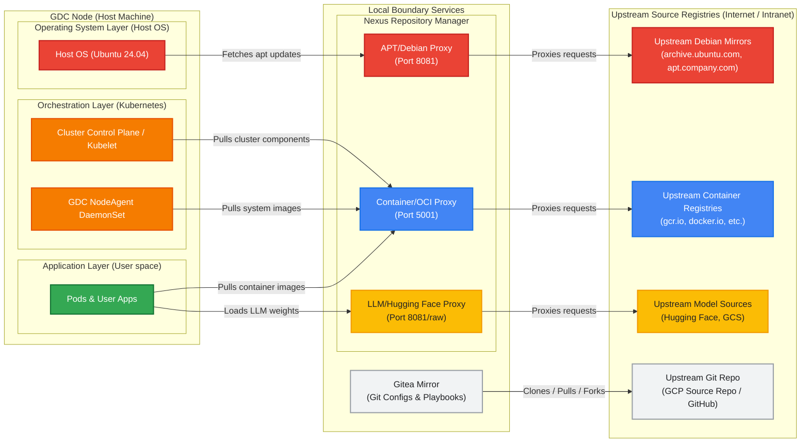
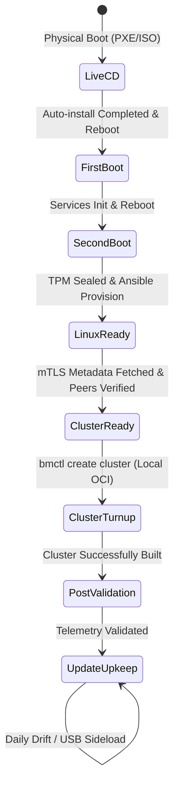

# GDC Node Provisioner - Architecture & Sequence Specification

This document details the complete end-to-end lifecycle of the Google Distributed Cloud (GDC) Bare Metal Node Provisioner pipeline. It outlines the sequence of transitions from initial variable configuration up to automated PXE-driven operating system installation, local Gitea hosting, and daily drift-correction execution via systemd timers.

---

## 1. End-to-End Sequence Diagram

The provisioning sequence is divided into four distinct stages:
1. **Stage 1 (ISO Creation):** Code and environment variables are compiled into a bootable, self-contained ISO containing pre-seeded Ansible playbooks, dependent collections, and local repositories.
2. **Stage 2 (Publish & Deploy):** The compiled ISO is uploaded to versioned Google Cloud Storage (GCS) or a local corporate NFS mount.
3. **Stage 3 (PXE Ingestion):** Bootimus (the PXE engine) pulls the ISO and configures local iPXE menus.
4. **Stage 4 (Bare-Metal Provisioning):** The physical node boots, performs a dynamic DHCP discovery install, transitions to local static VRF networking, and starts daily drift-correction.


---

## 2. Key Architecture Principles

### Evolutionary Architecture
System and platform architectures naturally evolve over time. To support long-term maintainability and adaptability, strict separation of interfaces from underlying implementations is required across all components. This abstraction allows individual modules, installers, and downstream providers to evolve or be swapped without breaking system boundaries or state contracts.

### Private Mode as a First-Class Citizen
While the majority of modern systems operate in loosely connected environments, `gdc-disk-provisioner` treats fully air-gapped ("Private Mode") operation as a primary, first-class citizen. For every system feature and capability, an explicit answer must exist for how it operates when completely disconnected. Even if accommodating Private Mode requires leveraging the Lowest Common Denominator (LCD) or results in certain GDC cloud-dependent features being reduced or non-applicable, this project will always define and deliver a clear, deterministic offline operation strategy.

### Design for Operational Simplicity
To reliably operate across thousands of distributed edge nodes at massive scale, operational simplicity is built into the foundation of the architecture. The system makes heavy use of declarative automation, desired state reconciliation engines (such as `ansible-pull`), eventual consistency models, and regular automated validation tests to ensure nodes autonomously converge on target states and remain healthy without human intervention.

### Hub-and-Spoke Sideloading & Proxy Pass-Thru Architecture



### 100% Offline-First (Local Gitea Hosting)
At ISO build time, our custom scripting clones the target Ansible playbooks repository as a read-only Git mirror and bakes it into Gitea's persistent data directories inside the ISO (`/custom-data/gitea/`). When the node boots into production, Gitea automatically launches and serves this exact bare Git repository locally on port `3000` via loopback. This ensures `ansible-pull` runs purely from local loopback with zero external network dependencies.

### Dual-Mode Sonatype Nexus Proxy (Local Package Mirrors)
On the **First Initial Boot** of the target machine, a local instance of Sonatype Nexus is automatically spun up on port `8081` to act as the local APT registry (`gdc-apt-proxy`):
*   **Connected Mode (Developer Labs & Connected Testing):** If the node has external internet connectivity, Nexus operates as an on-demand caching proxy. If a requested package is missing from the local cache, Nexus fetches it from public Ubuntu mirrors, caches it in its persistent local blob store, and serves it to the node's package manager.
*   **Air-Gapped Mode (Isolated GDC Production Targets):** In fully isolated production networks with no internet routing, Nexus operates completely offline. Because our remastering pipeline (`remaster.sh`) pre-populates and bundles every required system package (such as `ansible`, `git`, `python3`, and all of their python/system dependencies) directly into the offline GDC ISO during compilation, all required packages are guaranteed to already reside inside the local Nexus cache. If an un-cached package is requested, Nexus gracefully returns a `404/504` error instead of hanging on infinite timeouts, guaranteeing deterministic, 100% offline installation success.

### Deterministic Boot Order Policy (The Handoff Rule)
GDC Bare Metal nodes strictly enforce an automated bootloader handoff policy. Upon leaving the factory line, nodes are initialized in Network Boot (PXE) or USB boot mode. Following successful operating system writing during **Phase 1 (LiveCD)**, the system dynamically reconfigures the UEFI NVRAM boot order (utilizing `efibootmgr` on the Live CD host) to prioritize the newly written physical SSD/Disk. 
*   **Initial Boot:** Network PXE or USB is used for automated bare-metal provisioning.
*   **Subsequent Boots:** Local SSD/Disk is dynamically reordered as the primary boot target.
*   **Non-Destructive Fallbacks:** Secondary boot fallback points back to PXE, ensuring nodes remain recoverable/re-installable if the local OS bootloader ever gets corrupted, satisfying strict recovery constraints.

### Transition of Overarching Machine States
The GDC node transitions through an integrated, sequential state machine to ensure hardware and software readiness before cluster clustering commands are executed. Rather than running a single monolithic script, the system relies on structured boundaries:
*   **Sequential Stages:** Transitions progress from raw bootstrap (`LiveCD`) up to stable runtime and drift-correction (`Update/Upkeep`).
*   **State Cache:** High-performance, idempotent state JSON records are written to `/var/gdc-install/state/` to track and cache completion details.
*   **Detailed Machine State Model:** Refer to **Section 4: Overarching Machine States State Machine** below for detailed specs, state diagrams, and the node-agent firewall-shielding mechanism.

### Transition of Network Stages
* **Bootstrap Phase (Stage 1):** The Subiquity installer boots with native DHCP to establish a reliable connection to the `install-companion` log monitoring webhook.
* **Production Phase (Stage 2):** On the first reboot of the completed installation, systemd activates the segmented VRF (Virtual Routing and Forwarding) tables, mapping `Table 10` for "Machine" management interfaces and `Table 20` for "Kubernetes" container network interfaces natively or over tagged VLAN boundaries.

### Automated Drift Management
To prevent runtime configuration skew, the installer registers and starts a standard `gdc-provision.timer` systemd unit. Daily at the specified schedule (configured via `ANSIBLE_PULL_SCHEDULE`), this timer triggers `ansible-pull` to query the local Gitea instance and align the physical server with the declared git-state.

### AMD Zen 4 Bare-Metal Silicon & Firmware Compatibility Specification
Physical bare-metal deployments on AMD Ryzen Zen 4 (AM5) chipsets mandate dual-context kernel parameter separation to bypass low-level firmware deadlocks:
1. **Live CD Environment (Installation Phase):** `modprobe.blacklist=pcie_mp2_amd,amd_sfh,ccp` is enforced. Blacklisting the AMD Cryptographic Coprocessor (`ccp`) on the Live CD prevents Subiquity's `Filesystem/_probe` task from deadlocking the Platform Security Processor (PSP) bus when scanning raw NVMe sectors for pre-existing LUKS containers.
2. **Installed Target OS Environment (Production Phase):** `/target/etc/default/grub` is aggressively configured with `modprobe.blacklist=pcie_mp2_amd,amd_sfh,ccp` appended. This prevents the kernel from attempting to asynchronously load the module from the raw disk after `switch_root`, keeping the CPU perfectly stable.
3. **fTPM Hardware Interrupt Bypassing:** Both environments append `tpm_tis.interrupts=0` to the kernel command-line, forcing the built-in TPM driver to run in polling-only mode and bypassing the ACPI hardware interrupt storm bug present on AMD AM5 motherboards.
4. **Target-Side Systemd Ramdisk (`dracut`):** Because Ubuntu 24.04 noble removed `systemd-initramfs`, the installed target OS uses `dracut` to compile a 65MB hostonly systemd initrd, natively packaging `systemd-cryptsetup` and `systemd-cryptenroll` for passwordless TPM 2.0 PCR `0+7` volume unsealing.

### CI/CD Pipeline & Base ISO Caching
* **Cloud Build Integration:** The entire ISO remastering and compilation process is fully automated and runs within a **Google Cloud Build** CI/CD pipeline.
* **Base ISO GCS Caching:** To prevent unnecessary external network requests and guarantee high-speed, deterministic compilation, the "blessed" official Ubuntu 24.04 LTS Base ISO is cached inside a secure Google Cloud Storage (GCS) bucket. The Cloud Build pipeline fetches this cached base ISO directly from GCS into the workspace prior to starting the `remaster.sh` execution.

---

## 3. GDC Deterministic Stage-Gate Bootstrap Architecture

To eliminate temporal race conditions arising from hardware timing deviations (such as DRAM-less NVMe flush latencies or CPU clock scaling), the provisioner enforces a **Stage-Gate Execution Pattern with Barrier Blocking**.

The installation and bootstrapping process is divided into **7 Discrete Stages**. The system is strictly barred from proceeding from Stage $N$ to Stage $N+1$ until all entry/exit qualifications are successfully met. Each stage utilizes an explicit **Polling Loop with a Counter-based Timeout Ceiling** to avoid indefinite hangs.

```
+---------------------------------------+
|  Stage 1: HARDWARE_SETTLING           |
+---------------------------------------+
                   | (Disks stable, TPM, NICs present)
                   v
+---------------------------------------+
|  Stage 2: DISK_SANITIZATION           |
+---------------------------------------+
                   | (Wipefs done, mapper empty)
                   v
+---------------------------------------+
|  Stage 3: NAMESPACE_SYNC              |
+---------------------------------------+
                   | (Write loopback matches host)
                   v
+---------------------------------------+
|  Stage 4: STORAGE_LAYOUT              |
+---------------------------------------+
                   | (LVM created, LUKS container open)
                   v
+---------------------------------------+
|  Stage 5: OS_PAYLOAD                  |
+---------------------------------------+
                   | (/target populated, GRUB in EFI)
                   v
+---------------------------------------+
|  Stage 6: TPM_SEALING                 |
+---------------------------------------+
                   | (LUKS bound, temp key wiped)
                   v
+---------------------------------------+
|  Stage 7: BOUNDARY_HUB_TURNUP         |
+---------------------------------------+
                   | (Gitea/Nexus up, Ansible pull OK)
```

---

### Detailed Stage-Gate Specifications

#### Stage 1: Hardware Bus Settling & Enumeration (`HARDWARE_SETTLING`)
*   **Description:** Wait until physical controllers (PCI, USB, Storage, and TPM) have negotiated links and registered proper interfaces in the system bus.
*   **Entry Qualifications:** Linux Kernel successfully booted (initramfs loaded).
*   **Exit Qualifications:**
    *   Target disk is detected with a physical model name and size $> 0$ sectors.
    *   TPM character device nodes `/dev/tpm0` and `/dev/tpmrm0` are present.
    *   Primary physical NIC (e.g., `enp1s0`) is registered and active.
*   **Error / Failure Handling:** If assertions fail after 30 seconds (30 polls of 1.0s), abort installation and drop to the `crash-cart` debug console.

#### Stage 2: Disk Sanitization & Interface Purge (`DISK_SANITIZATION`)
*   **Description:** Clear the installation drive of residual partitions, signatures, logical volumes, or encrypted mappings that might conflict with partition maps.
*   **Entry Qualifications:** Stage 1 (`HARDWARE_SETTLING`) successfully completed.
*   **Exit Qualifications:**
    *   `wipefs` returns zero active signatures on the block device.
    *   Device-mapper directories (`/dev/mapper/*`) contain no active system logical volumes or conflicting crypt tunnels.
    *   `/proc/mdstat` indicates no software RAID layers are bound to the disk.
*   **Error / Failure Handling:** If drive sanitization or volume close fails after 15 seconds (15 polls of 1.0s), mark partition layout as `FAILED` and log trace.

#### Stage 3: Cross-Namespace Integrity Verification (`NAMESPACE_SYNC`)
*   **Description:** Mitigate snap-to-host mount namespace write propagation delays.
*   **Entry Qualifications:** Stage 2 (`DISK_SANITIZATION`) successfully completed.
*   **Exit Qualifications:**
    *   A test string written inside the Subiquity/Snap private namespace successfully appears in the host overlayfs with matching cryptographic hash within 5.0 seconds (50 polls of 0.1s).
    *   The staging key file is verified as non-empty (size $> 0$) and readable in both namespaces.
*   **Error / Failure Handling:** If file propagation times out, halt installation immediately to prevent formatting with an empty (0-byte) key.

#### Stage 4: Storage Structure & Partitioning (`STORAGE_LAYOUT`)
*   **Description:** Partition disks, initialize LUKS2 containers, and configure the LVM volume group.
*   **Entry Qualifications:** Stage 3 (`NAMESPACE_SYNC`) successfully completed.
*   **Exit Qualifications:**
    *   `cryptsetup` successfully formats and maps `/dev/mapper/crypt-system` using the valid staging key.
    *   Volume group `vg_system` and all 11 required logical volumes are queryable and show expected sizes.
*   **Error / Failure Handling:** If `cryptsetup` formats using a fallback or empty key, or if partition offsets fail to align, abort and write a core installer crash dump.

#### Stage 5: OS Payload Injection & Bootloader Stage (`OS_PAYLOAD`)
*   **Description:** Write base OS filesystem payload, mount essential paths, configure EFI bootloader settings, and compile the systemd-based initramfs using native initramfs-tools.
*   **Entry Qualifications:** Stage 4 (`STORAGE_LAYOUT`) successfully completed.
*   **Exit Qualifications:**
    *   System structures mounted under `/target` match target specifications.
    *   UEFI GRUB bootloader successfully written to partition 1 with the module blacklist `modprobe.blacklist=pcie_mp2_amd,amd_sfh` and `tpm_tis.interrupts=0` appended to the kernel cmdline to prevent early fTPM deadlocks on AMD platforms.
    *   `initramfs-tools` and `cryptsetup-initramfs` successfully compile a highly optimized (35MB) boot ramdisk containing `crypt` and `lvm` modules, and packages `/etc/keys/temp_key.key` (represented inside initrd as `/cryptroot/keyfiles/crypt-system.key`) to allow passwordless first-boot decryption. A custom, alphabetically late compile hook (`zz-gdc-blacklist`) executes at the very end of the staging phase to surgically prune blacklisted deadlock modules (`amd_sfh.ko.zst`).
    *   **Pre-Reboot Initramfs Validation Checks:** The Subiquity `late-commands` automatically execute `lsinitramfs` to run five programmatic assertions verifying:
        1. Transition keyfile presence.
        2. `crypt` decryption module inclusion.
        3. `lvm` logical volume module inclusion.
        4. Physical storage controller (NVMe/SATA) drivers inclusion.
        5. Absolute exclusion of fTPM-deadlocking drivers (`pcie_mp2_amd` and `amd_sfh`).
*   **Error / Failure Handling:** If GRUB fails to write, or if any of the five pre-reboot initramfs assertions fail, the installer halts execution immediately, writes the exit status to `/dev/ttyS0`, and reports the error to GDC Companion, blocking reboot to prevent silent black-screen hangs.

#### Stage 6: First-Boot Security Sealing & Key Sanitization (`TPM_SEALING`)
*   **Description:** Bind the LUKS volume encryption to the physical TPM 2.0 PCR registers and wipe transient keys.
*   **Entry Qualifications:** First boot of the target OS initiated; Stage 5 completed.
*   **Exit Qualifications:**
    *   `systemd-cryptenroll` binds the key to PCRs `0+7` on `/dev/tpmrm0`.
    *   The temporary boot keyfile `/boot/temp_key.key` is cryptographically shredded (via `shred -u`) and its keyslot is cleared.
*   **Error / Failure Handling:** If TPM enrollment fails, keep the fallback recovery key and register a critical warning with the diagnostics subsystem to block standalone cluster enrollment.

#### Stage 7: Local Boundary Hubs & Playbook Execution (`BOUNDARY_HUB_TURNUP`)
*   **Description:** Initialize the local offline caches (Gitea and Nexus) and run the local `ansible-pull` playbooks.
*   **Entry Qualifications:** Node booted, Stage 6 (`TPM_SEALING`) successfully verified.
*   **Exit Qualifications:**
    *   Ports `3000` (Gitea) and `8081` (Nexus) respond with successful HTTP handshakes.
    *   `ansible-pull` completes execution with exit code `0`.
*   **Error / Failure Handling:** If ports do not open within 120 seconds (60 polls of 2.0s), automatically trigger `@bin/collect-node-diagnostics.sh` and push the diagnostics bundle to `gdc-companion`.

---

### Progress Tracking & Verification Evidence
To enable real-time tracking of node state transitions in the **GDC Companion** application, the `collect-node-diagnostics.sh` script automatically records and transmits the current completed stage. The status payload includes:
1.  **Stage ID:** Current active stage string (e.g., `NAMESPACE_SYNC`).
2.  **State Status:** `PENDING`, `IN_PROGRESS`, `COMPLETED`, or `FAILED`.
3.  **Verification Evidence:** Specific telemetry readings (e.g., MAC, disk sizes, partition mounts, socket statuses) acting as proof of transition.

---

## 4. Overarching Machine States State Machine

To coordinate node bootstrap across separate reboots and prevent premature cluster sync operations, each physical node implements a strict sequential state-machine pattern.

### 4.1. State Machine Transition Diagram



### 4.1.2. AI-Readable State-Transition Matrix

For automated tools, AI agents, and LLMs, this text-based state-transition model explicitly defines the active states, input triggers, transition actions, and target SENTINEL conditions:

| Source State | Input Trigger | Transition Operation (Action) | Target State | State Cache Sentinel |
| :--- | :--- | :--- | :--- | :--- |
| `[None]` | Cold Boot | UEFI reads GDC Bootloader ISO, launches Subiquity and curtin scripts. | `LiveCD` | `[None]` |
| `LiveCD` (Stage 1) | Installation loop completes cleanly. | Late-commands write `provision.yml` and copy Nexus/Gitea caches to LVM, then trigger reboot. | `FirstBoot` | Target disk OS boots successfully, managed by `stages/stage_first_boot.yml` via `import_tasks`. |
| `FirstBoot` (Stage 2) | Node boots on target SSD first time. | Runs `service_hubs` (Gitea/Nexus), registers TPM LUKS keyslots, erases `/boot/temp_key.key`, then triggers controlled reboot. | `SecondBoot` | `/var/gdc-install/state/first-boot.json` status = `"completed"` |
| `SecondBoot` (Stage 3) | Node boots on physical disk second time. | Verification suite asserts Port 3000/8081 health and LUKS auto-decryption, then transitions to hardening. | `LinuxReady` | `/var/gdc-install/state/second-boot.json` status = `"completed"` |
| `LinuxReady` (Stage 4) | System auto-unlocked successfully. | Playbook executes standard foundations, UTC time-sync, CIS Level 2 hardening, and purges Snapd/LXD packages. | `ClusterReady` | `/var/gdc-install/state/linux-ready.json` status = `"completed"` |
| `ClusterReady` (Stage 5) | Ready-Linux baseline completed. | Calls `/v1/machine-info/{mac}`, templates `/etc/hosts` peers, stages `nodeagentd` binaries, authenticates `gcloud`, and starts `node-agent.service`. | `ClusterTurnup` | `/var/gdc-install/state/cluster-ready.json` status = `"completed"` |
| `ClusterTurnup` (Stage 6) | GGD dynamic configuration ready. | Executes offline standalone/HA cluster inception (`bmctl create cluster`) pulling OCI layers from local loopback (Port 5001). | `PostValidation` | Cluster kubeconfig is successfully written and active. |
| `PostValidation` (Stage 7)| Kubernetes control plane marked `Ready`. | Executes automated sanity test suite verifying CoreDNS lookup, Storage Classes, MetalLB VIPs, and pushes validation report. | `UpdateUpkeep` | `/var/gdc-install/state/post-validation.json` status = `"completed"` |
| `UpdateUpkeep` (Stage 8) | Validation metrics successfully pushed. | systemd timer triggers periodic `ansible-pull` drift correction, and udev auto-triggers USB update bundles. | `UpdateUpkeep` | Playbook runs with `changed=0` (stable convergence). |

### 4.2. Stage-by-Stage Specifications

Each stage has an explicit meaning and a clear, objective measurement strategy to determine if it is complete. If a stage fails its measurement checks, the idempotent Ansible post-install runner automatically attempts a self-repair before flagging the stage as complete.

| Stage | Name | Description | Completion Measurement |
| :--- | :--- | :--- | :--- |
| **1** | `LiveCD` | Physical server runs in RAM from the read-only GDC Bootloader ISO, executing disk partitioning, LVM formatting, base filesystems preparation, and pre-seeding sync of Gitea/Nexus assets to disk. | 1. The node successfully completes installation and boots into the physical disk operating system. |
| **2** | `FirstBoot` | Node boots from local NVMe/SSD, unseals LUKS, starts Gitea/Nexus service hubs, and executes initial `ansible-pull` bootstrap logic to establish dependency keys. | 1. Port `3000` (Gitea) and `8081` (Nexus) respond with `200 OK` on loopback.<br>2. `/var/gdc-install/state/first-boot.json` status is `"completed"`. |
| **3** | `SecondBoot` | Controlled system reboot is executed to verify bootloader, UEFI, and crypttab unsealing stability without human passphrase intervention. | 1. System reboots successfully to multi-user target without hanging.<br>2. `/var/gdc-install/state/second-boot.json` status is `"completed"`. |
| **4** | `LinuxReady` | Ansible playbook applies system tuning, CIS level 2 security hardening, purges Snapd/LXD packages, installs local tools (Google Cloud SDK), and validates core offline system dependencies. | 1. Success of system verify script (`verify_ansible.sh`).<br>2. `/var/gdc-install/state/linux-ready.json` status is `"completed"`. |
| **5** | `ClusterReady` | Node fetches dynamic configurations from GDC Companion (`GET /v1/machine-info/{mac-address}`), populates `bmctl` on `$PATH`, stages the `NodeAgent` binary and mTLS certificates, authenticates `gcloud`, configures `/etc/hosts`, and passes peer validation. | 1. `bmctl` executable exists on `$PATH`.<br>2. `/etc/hosts` contains peer IP/hostname entries.<br>3. `gcloud auth list` confirms valid credentials.<br>4. `/var/gdc-install/state/cluster-ready.json` status is `"completed"`. |
| **6** | `ClusterTurnup` | Node executes offline standalone cluster creation using local Nexus Group Registry (Port `5001`) via `bmctl create cluster` and deploys the GDC NodeAgent. | 1. Admin kubeconfig exists at `/root/bmctl-workspace/gdc-edge-cluster/gdc-edge-cluster-kubeconfig`.<br>2. All control plane pods are marked `Ready`. |
| **7** | `PostValidation` | Automated post-install test suite validates storage classes, DNS resolution, and CNI connectivity. | 1. CoreDNS lookup succeeds internally.<br>2. Telemetry metrics flow smoothly to central collectors. |
| **8** | `UpdateUpkeep` | Daily systemd timer triggers `ansible-pull` for local drift correction, and udev rules orchestrate headless USB sideload updates. | 1. Playbook execution finishes with `changed=0` (stable convergence). |

### 4.3. State Storage & Performance Caching

To ensure the node can survive nested VM restarts, random hypervisor hyper-threads crashes, and physical power outages, the completed states are stored in high-performance JSON cache files inside the GDC management directory:

```bash
/var/gdc-install/state/{stage_name}.json
```

Because all GDC configuration items are designed to be completely idempotent, these files act strictly as an optimization cache to avoid redundant, expensive remote calls (e.g. hitting GDC Companion every minute during loop executions). If any state file is deleted or invalidated, the runner automatically re-calculates and re-verifies the state to rebuild the cache files.

### 4.4. The NodeAgent Service Gating Gate

#### A. The Problem of Asynchronous Booting
In multi-node cluster topologies, nodes do not boot or provision at identical speeds due to variations in UEFI post times, memory training sequences, or NVMe performance. If a node starts GDC NodeAgent on Port `9192` too early:
*   It immediately attempts to scan and connect with peer nodes that may still be mid-installation in `LiveCD` or `FirstBoot`.
*   This causes mutual TLS connection timeouts, error spam in logs, and can cause `bmctl` pre-flight checks to fail or hang indefinitely.

#### B. The Service Gating Rule
To enforce deterministic peer synchronization without introducing complex, platform-specific firewall configuration dependencies, we control the lifecycle of the `node-agent` systemd service:
1.  **Service Disabled & Stopped (Early Stages):** During `LiveCD`, `FirstBoot`, `SecondBoot`, and `LinuxReady` stages, the `node-agent` systemd service is explicitly kept in a `stopped` and `disabled` state on the node.
2.  **State Gating:** With `node-agent` inactive, the node remains completely isolated, focusing purely on its local post-install hardening, package caching, and host-level verification. No sockets are opened on Port `9192`.
3.  **Activating NodeAgent (Un-gating):** Only when the node successfully transitions to `ClusterReady` (confirming all host configurations are verified, `/etc/hosts` mapping is complete, and the Companion API configuration is fully fetched and validated) does the playbook activate the service:
    ```bash
    systemctl enable --now node-agent.service
    ```
4.  **Symmetrical Discovery:** Because every node in the cluster plays by the exact same rules, peer nodes will only have active `node-agent` servers listening and handshaking when both sides have entered the `ClusterReady` boundary. This guarantees that any inter-node cluster control plane and peer discovery requests are executed cleanly and symmetrically between fully prepared nodes.
