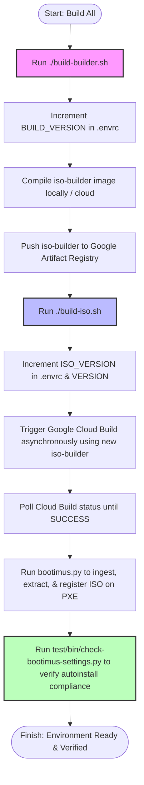
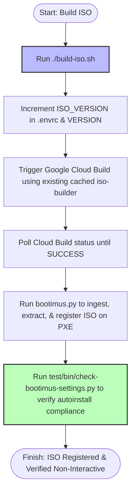
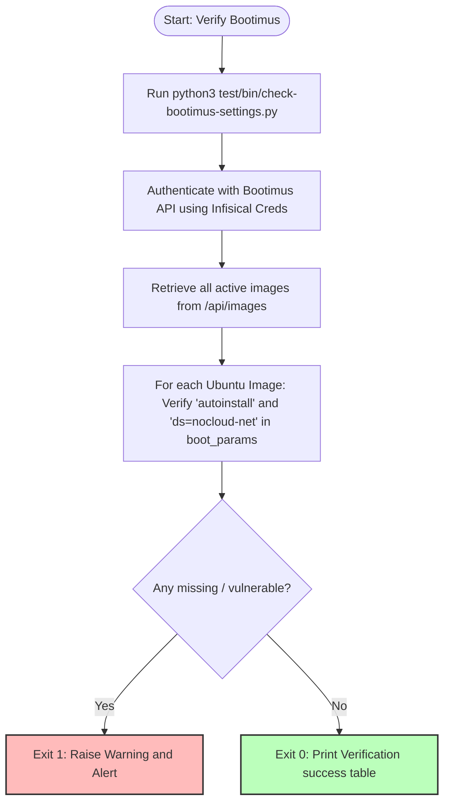

# GDC Disk Provisioner Development & Release Engineering Manual

This manual governs the local development, compilation, validation, and release pipelines of the Google Distributed Cloud (GDC) Offline Bootloader ISO. It represents our standard, target development lifecycle, enforcing strict consistency across both **local workstation runs** and **remote cloud builds (CI/CD)**.

---


### Critical Development Dependencies

* **Smallstep CA (`step-ca`):** The zero-touch hardware attestation workflow absolutely requires a centralized `step-ca` server. Ensure this service (e.g., `https://step-ca.ensor-labs.com`) is operational before attempting to test the `machine_orchestration` Ansible playbook, as the nodes will fail to acquire mTLS certificates and GCP access tokens without it.
* **Bootimus PXE Server:** If you are running `make ingest-pxe` or heavily developing the `remaster.sh` pipelines, a Bootimus PXE server is heavily recommended. The `bootimus.py` scripts enforce strict, stable-state synchronization with the Bootimus database.

## 1. Architectural Philosophy & Core Tenets

All development actions in this repository must align with the core standards defined in `GEMINI.md`:
1.  **Air-gapped Isolation:** All GDC system installations on the target machine pull from local boundaries (Gitea/Nexus Service Hubs) rather than public endpoints.
2.  **YAGNI & Minimalism:** Avoid heavy virtual machine pre-compilers or Packer scripts. Standard UNIX system utilities (`xorriso`, `rsync`, Python/Jinja2) are the project standards.
3.  **outer FS Overlays:** Do not touch or compress the base OS `filesystem.squashfs` image. Keep configurations and Gitea/Nexus payload folders strictly in the outer ISO filesystem overlay (`/custom-data/` overlays) to keep compile times under 10 seconds.
4.  **No In-Line Configurations (Prefer Declarative Templates):** Do not write dynamic configuration text blocks inside bash code. Define layouts cleanly as Jinja2 templates under `src/build/templates/` and hydrate them dynamically.
5.  **Active Probing (Do Not Guess):** Avoid hardcoded hardware or network properties. Code must probe local disk counts, device types, interface adapters, and port bindings at runtime.

---

## 2. Environment Variables & Configuration Overrides

The build engine utilizes two configuration files in `src/build/` to drive variable hydration:

*   **`build.env` (Default parameters - Committed to Git):**
    Holds non-sensitive default parameters (e.g. `SOURCE_ISO_URL`, default `ANSIBLE_PULL_SCHEDULE`, default GCS buckets, and required binary download URLs/SHA-256 hashes).
*   **`local.env` (Personal overrides - Git-Ignored):**
    Used to inject secure passwords (`TEMPORARY_INSTALLER_PASSWORD`), administrative SSH keys (`ADMIN_SSH_PUB_KEYS`), network overrides, or target VLAN identifiers.
*   **`add-hosts` (Custom DNS overrides - Git-Ignored):**
    Placing an `/etc/hosts`-formatted file named `add-hosts` under `src/build/` allows injecting custom host mappings during deployment.
    By default, these mappings are only injected into the installer's live CD environment (`/etc/hosts`) in `early-commands` to bypass boot-time DNS resolutions.
    If you also want these mappings to persist inside the installed target operating system's persistent `/etc/hosts` file post-reboot, define `PERSIST_ADD_HOSTS=true` inside `local.env` or `build.env`.
    
*Note on Secret Hygiene: Plain-text secrets or keys must never be committed to Git. The build system automatically reads plain text from `local.env`, hashes credentials dynamically using salted SHA-512 crypt algorithms at build-time, and injects only the secure hashes into target configurations.*

---

## 3. Discrete Lifecycle Stages & Stage-Gate Pipeline

To ensure absolute repeatability and short debug feedback loops, the entire project lifecycle is broken down into structured, named **Stages** and individual **Phases** mapped directly to non-interactive `make` targets.

### Lifecycle Stage-Gate Matrix

| Stage Name | Lifecycle Stage Code | Trigger Command | Expected Dependencies Verified Before Running | Gate Validation Criterion |
| :--- | :--- | :--- | :--- | :--- |
| **Check Env** | `check-env` | `make check-env` | • System tools: `xorriso`, `rsync`, `curl`, `python3`. | • Environment variables loaded successfully.<br>• Warns if `/dev/kvm` is missing (slow dynamic tests). |
| **Stage 1:<br>Pre-Artifact** | `pre-artifact` | `make deps`<br>`make hydrate` | • `make check-env` success.<br>• Binary caches folder `.cache/` exists. | • Binary integrity verified via SHA-256 checksums.<br>• All template configurations (`user-data.j2`, etc.) hydrated. |
| **Stage 2:<br>Validate** | `validate-artifact` | `make validate` | • `make hydrate` success.<br>• Python dependencies (`pyyaml`, `jinja2`). | • **Zero Schema Errors:** Hydrated `user-data` passes `cloud-init schema` syntax checks.<br>• All Bash files pass `shellcheck`. |
| **Stage 3:<br>Assemble** | `assemble-artifact` | `make assemble` | • `make validate` success.<br>• Gitea & Nexus offline binaries ready. | • Compiles the custom GDC bootloader ISO (`.iso`) under 10 seconds. |
| **Stage 4:<br>Test** | `test-artifact` | `make test-static`<br>`make test-dynamic` | • `make assemble` success.<br>• QEMU and `swtpm` tools installed. | • **Static:** verifies file table layout within the compiled ISO.<br>• **Dynamic:** Node boots, runs `ansible-pull`, and logs `GDC_BOOTSTRAP_COMPLETE_SUCCESSFULLY`. |
| **Stage 5:<br>Release** | `release-artifact` | `make deploy` | • `make test-dynamic` success.<br>• Remote write credentials (GCP auth). | • ISO candidates are securely written to GCS or corporate NFS mounts. |
| **Stage 6:<br>Ready** | `ready-artifact` | `make ingest-pxe` | • `make deploy` success.<br>• Connection to local PXE / Bootimus servers. | • Downloads ISO and registers the candidate in network PXE configurations. |
| **Stage 7:<br>Publish** | `publish-artifact` | `make publish` | • Fully verified and tested ISO candidate. | • Automatically generates `gdc-bootstrap-v1.x.x-provenance.json` manifest.<br>• Atomically updates `gdc-bootstrap-latest-verified.iso` symbolic link. |

---

## 4. Comprehensive Stage-by-Step Guide

### Stage 1: Pre-Artifact
Handles the acquisition of dependencies and template rendering.
1.  **Binary Caching (`make deps`):**
    Downloads Gitea, JRE, and Sonatype Nexus tarballs. It calculates and compares SHA-256 signatures to block corrupted components. Already-cached files are retained to eliminate internet download delays.
2.  **Jinja2 Hydration (`make hydrate`):**
    Build variables from `build.env` and `local.env` are processed through `src/build/render_templates.py`. This hydrates clean templates:
    *   `nocloud/user-data` (Subiquity configuration)
    *   `nocloud/meta-data` (Hostname settings)
    *   `custom-data/network-template.yaml` (Netplan configurations)
    *   `custom-data/systemd/` (Service unit files)

    **Note on Binary Acquisition:** In Cloud Build CI/CD pipelines, the `.cache/` directory is excluded via `.gcloudignore` to prevent massive gigabyte uploads of raw ISOs and binaries from the local workstation. Instead, `cloudbuild.yaml` runs a sequence of `gcloud storage cp` commands during Step 1 to download the dependencies directly from the `gs://<bucket>/binaries/` and `gs://<bucket>/packages/` prefixes into the isolated Cloud Build worker `.cache` structure. 
    
    The `src/build/remaster.sh` script is strictly configured to only pull its payloads (like `collect-diagnostics.sh`) from this local `.cache/` folder. If a binary is missing from the cache during the Assemble phase, it will hard fail the build. This ensures hermetic, predictable assemblies.
    
    *Frequently Asked Question: Could we mount the GCS Bucket using FUSE instead of copying files down via `gcloud storage cp`?*
    > **Answer:** Yes, it is technically possible to mount a GCS bucket using Cloud Storage FUSE (`gcsfuse`) inside the Cloud Build container by running it in `--privileged` mode. However, we intentionally do not do this for two reasons:
    > 1. **I/O Performance Penalty:** `gcsfuse` translates POSIX file read requests into HTTPS GET requests. When `xorriso` runs to compile the ISO, it performs intense sequential and random I/O reads. Reading a 4GB ISO byte-by-byte over a FUSE network translation layer is significantly slower and more prone to timeouts than doing a fast, parallelized `gcloud storage cp` to the local worker SSD first, and then running `xorriso` locally.
    > 2. **Container Complexity:** Because each Cloud Build step runs in its isolated Docker container, keeping a FUSE mount alive across multiple steps requires complex Docker volume mapping and background daemon management, which violates our core tenet of minimalism.

### Stage 2: Validate-Artifact (`make validate`)
Before packing the ISO, this gate ensures that all hydrated configurations conform to system schemas:
```bash
# Executed within validate target
cloud-init schema --config-file build-workspace/custom-iso/nocloud/user-data
yamllint build-workspace/custom-iso/custom-data/network-template.yaml
shellcheck src/build/generate_storage_config.sh
```
*If a syntax or spacing error is discovered, the build halts immediately.*

### Stage 3: Assemble-Artifact (`make assemble`)
Orchestrates the creation of the bootable media:
*   Pre-seeds a read-only Gitea clone of our installation playbooks (`UPSTREAM_PLAYBOOKS_REPO`), injecting a custom `pre-receive` block to restrict direct target-side commits.
*   Writes a dynamically rendered Message of the Day (MOTD) banner containing the compilation version and timestamp.
*   Deletes `/md5sum.txt` to bypass Casper media integrity verification checks.
*   Invokes `xorriso` to pack the files non-interactively into a hybrid EFI-bootable ISO.

### Stage 4: Test-Artifact (`make test-static` & `make test-dynamic`)
Runs automated testing loops:
*   **Static (`make test-static`):** Checks file signatures and extracts and validates structural layout files from the unmounted `.iso` file via `./test/validate_iso_static.py`.
*   **Dynamic (`make test-dynamic`):** Runs `test/run_qemu_e2e.sh` which:
    1.  Provisions two sparse block devices (250GB System disk, 350GB Data disk).
    2.  Spawns an isolated `swtpm` daemon under a randomized directory to prevent port/socket conflicts.
    3.  Launches a headless QEMU virtual machine, forwarding host port `2222` to guest `22` strictly on the loopback adapter (`127.0.0.1`) to secure the test container.
    4.  Injects a short-lived ephemeral SSH key pair for post-install assertions.
    5.  Polls the guest VM's `/dev/ttyS0` serial output for the completion token: `GDC_BOOTSTRAP_COMPLETE_SUCCESSFULLY`.
    6.  Runs remote SSH assertions verifying logical volume sizes, Service Hub port bindings, and TPM key sealing status.
    7.  Kills subprocesses and wipes temp files cleanly via a global bash `trap` exit signal.

### Stage 5: Release-Artifact (`make deploy`)
Pushes verified versioned ISO candidates (`gdc-bootstrap-ubuntu-24.04-v1.x.x.iso`) to either GCS bucket destinations or target NFS directories.

### Stage 6: Ready-Artifact (`make ingest-pxe`)
Pulls the candidate ISO into the physical bare-metal lab PXE directory and updates network-boot configuration maps.

### Stage 7: Publish-Artifact (`make publish`)
The final promotion gate. Marks a specific tested ISO candidate as officially production-ready:
*   Updates an atomic symbolic link pointing to the latest validated release.
*   Creates a signed **Provenance Manifest** file detailing:
    *   Build version, commit, and timestamp.
    *   Host OS details and compiler toolchain versions (`xorriso`, Python, Jinja2).
    *   SHA-256 hashes of all third-party dependencies.
    *   E2E execution logs and static linter report digests.

---

---

## 5. Build Scenarios & Compilation Workflows

Depending on whether you are initializing a new build environment, developing templates, or performing quality assurance audits on the PXE server, you can trigger one of three structured pipelines.

### Scenario A: Build All (Complete Pipeline)
*   **Trigger:** `./build-builder.sh` followed by `./build-iso.sh`
*   **Use Case:** Compiling a new `iso-builder` compilation environment container (e.g., when dependencies, python compilers, or shell checkers change) and then building and deploying a fresh ISO.
*   **Workflow:**



---

### Scenario B: Build ISO (Most Common Flow)
*   **Trigger:** `./build-iso.sh`
*   **Use Case:** **The primary developer loop.** Used to compile a new version of the GDC installer ISO using pre-compiled, cached container runtimes, automatically registering it and locking it in secure, non-interactive mode on the Bootimus server.
*   **Workflow:**



---

### Scenario C: Verify Bootimus (Standalone Verification)
*   **Trigger:** `python3 test/bin/check-bootimus-settings.py`
*   **Use Case:** Standalone verification audit. Connects directly to the Bootimus API to verify that all registered GDC target images are locked into secure, non-interactive autoinstall configurations, preventing any node from entering interactive console prompts.
*   **Workflow:**



---

## 6. Local Workstation vs. CI/CD Cloud Build Alignment

To prevent drift between developer environments and automated release systems, **both local and remote runs execute the exact same Stage-Gate targets**.

### Local Workstation Development Flow:
```bash
# 1. Hydrate and validate templates locally
make pre-artifact && make validate-artifact

# 2. Compile and run E2E headless tests locally
make assemble-artifact && make test-artifact
```

### Remote CI/CD Cloud Build Flow (`cloudbuild.yaml`):
The remote build pipeline mimics this sequence step-for-step using custom container images. Rather than inventing distinct commands for Cloud Build, `cloudbuild.yaml` acts as a clean orchestrator invoking our core `make` targets:

```yaml
# Schema of cloudbuild.yaml aligning with development Makefile
steps:
  # 1. Pull base ISO from GCS source caches
  - name: 'gcr.io/cloud-builders/gcloud'
    id: 'pull-source-iso'
    entrypoint: 'bash'
    args: ['-c', 'make -C src/build deps']

  # 2. Hydrate, Validate and Assemble Custom GDC ISO
  - name: 'us-central1-docker.pkg.dev/my-project/iso-builder:1.0.0'
    id: 'build-and-validate-iso'
    entrypoint: 'bash'
    args: ['-c', 'make -C src/build hydrate && make -C src/build validate && make -C src/build assemble']

  # 3. Dynamic QEMU dynamic tests (if nested-virtualization runner is active)
  - name: 'us-central1-docker.pkg.dev/my-project/iso-builder:1.0.0'
    id: 'run-e2e-assertions'
    entrypoint: 'bash'
    args: ['-c', 'make -C src/build test-static && make -C src/build test-dynamic']

  # 4. Push verified ISO candidate and generate Provenance Manifest
  - name: 'gcr.io/cloud-builders/gcloud'
    id: 'publish-and-promote'
    entrypoint: 'bash'
    args: ['-c', 'make -C src/build deploy && make -C src/build publish']
```
This guarantees that any syntax errors or build anomalies are identical and reproducible regardless of where the compiler is triggered.

---

## 7. Remote Diagnostics & Stage-Gate Health Monitoring

This project includes a fully automated post-provisioning **Diagnostics & Health-Check Suite** designed to collect, parse, and verify active bare-metal nodes completely headlessly. It maps retrieved system logs directly to the respective **GDC Lifecycle Stages** for high-visibility forensics.

### A. The In-Target Diagnostics Collector (`collect-diagnostics.sh`)
Baked directly into every custom ISO at `/usr/local/bin/collect-diagnostics.sh`, this local script aggregates core OS telemetry, Netplan configs, systemd journals, LVM mappings, and Google API DNS/TCP audits.

*   **Manual Trigger on Node:**
    ```bash
    # SSH into the node and run manually:
    echo "temporary-installer-password-here" | sudo -S /usr/local/bin/collect-diagnostics.sh
    ```
*   **Artifact Output:**
    Generates a versioned tarball at `~/gdc-node-diagnostics-<TIMESTAMP>.tar.gz` and copies it to physical root mount partitions to survive system reboots.

### B. The Remote Orchestrator & Analyzer (`gdc-diagnostics-transmit-analyze.py`)
Located locally under `bin/gdc-diagnostics-transmit-analyze.py`, this Python script automates node health collection across multiple IPs or subnets in parallel, pulls and extracts tarballs, executes regex log searches, and compiles a dual-format **Markdown & JSON Report**.

*   **Preferred Execution (Automated Subnet Scan):**
    For security hygiene (preventing password history tracking) and dynamic DHCP IP discovery, run with the inline `GDC_PASSWORD` variable and `--scan <CIDR>` option:
    ```bash
    GDC_PASSWORD="temporary-installer-password-here" ./bin/gdc-diagnostics-transmit-analyze.py --scan "192.168.1.230/28" --output-dir "/tmp/gdc-diagnostics"
    ```
*   **Alternative Execution (Explicit IP List):**
    ```bash
    GDC_PASSWORD="temporary-installer-password-here" ./bin/gdc-diagnostics-transmit-analyze.py --ips "192.168.1.241,192.168.1.242" --output-dir "/tmp/gdc-diagnostics"
    ```
*   **Main Outcomes Produced:**
    1.  📄 **`health_report.md` (Human-readable):** Rich, structured Markdown report linking to syntax-highlighted error logs.
    2.  ⚙️ **`health_report.json` (Machine-parseable):** JSON health status schema, ideal for CI/CD assertions and telemetry collectors.

---

## 8. Stage-Gate Log Diagnostics Reference

When debugging a node, map failures directly to the GDC Lifecycle Stages using the retrieved diagnostic log directory:

### Phase 1: LiveCD State (ISO Generation & Unattended Install)
*   **Logs to check:** `logs/casper-md5check.json`, `report.json`
*   **Verification:** Ensure build banners are correct and the live CD boot integrity checksum is passing.

### Phase 2: First Boot State (Services Hubs Setup & TPM Sealing)
*   **Logs to check:** `logs/subiquity-server-debug.log`, `logs/curtin-install.log`, `logs/installer-journal.txt`, `dmesg.txt`
*   **Verification:** Check for disk layout configurations, partition formatting failures, or `apparmor="DENIED"` events during the Subiquity unattended install.

### Phase 3 & 4: Second Boot & Linux Ready State (Verify Auto-Unlock & CIS Hardening)
*   **Logs to check:** `logs/gdc-provision.log`, `logs/ssh.log`, `report.json`
*   **Verification:** Confirm that first-boot `ansible-pull` playbooks executed to completion with zero failures and generated the completion token `GDC_BOOTSTRAP_COMPLETE_SUCCESSFULLY`.

### Phase 5: Cluster Ready State (Companion Configurations & NodeAgent Gating)
*   **Logs to check:** `logs/gitea.log`, `logs/nexus.log`, `report.json`
*   **Verification:** Confirm Port `3000` (Gitea) and Port `8081` (Nexus) respond to HTTP health handshakes and local OCI registries are active.

### Phase 6, 7 & 8: Cluster Turnup, Post-Cluster Validation & Upkeep (bmctl, CNI, & Drift)
*   **Logs to check:** `report.json`, `health_report.md` (mutual pings matrix)
*   **Verification:** Verify that outbound DNS/TCP connection to Google endpoints succeed and mutual ping connectivity between all node interfaces is 100% active.
