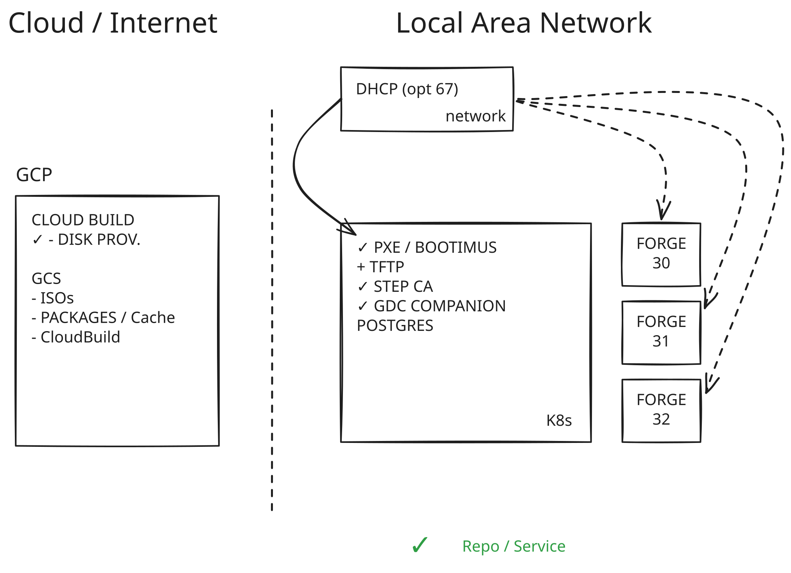

# GDC Disk Provisioner - Local Lab Setup Guide

## 1. Overview

This document outlines how to build a local GDC Bare Metal test lab from scratch. It guides you chronologically through hardware acquisition, network configuration, cloud dependencies, and local service spin-up required to successfully build, test, and deploy GDC Bare Metal nodes using the automated ISO provisioner.

*Reference Diagram: [Lab Setup Architecture](https://link.excalidraw.com/l/Am9BEhX3AX3/94pMi8XMnvQ)*



## 2. Hardware & Network Prerequisites

### 2.1 Target Machine Hardware

*(Consult the [official GDC node machine prerequisites](https://docs.cloud.google.com/kubernetes-engine/distributed-cloud/bare-metal/docs/installing/node-machine-prerequisites) for full production details. For this local lab, the following minimums apply:)*

* **Computers:** 1 or more physical computers.
* **CPU:** 4 physical cores (8 vCPU with hyperthreading).
* **RAM:** 16GB minimum.
* **Storage:** 500GB SSD or NVMe minimum. Additional disks are supported and welcome.

### 2.2 Network Infrastructure

* **IP Space:** A minimum of a `/24` RFC1918 IPv4 subnet.
* **Gateway:** A dedicated Gateway IP.
* **DHCP:** A DHCP Server with network booting (PXE) capabilities.
* **TFTP:** TFTP capability (hosted via a NAS, local disk, or advanced router) to serve the initial PXE bootloader.

## 3. Cloud & Core Network Configuration

### 3.1 GCP Cloud Build Dependencies

The ISO build pipeline relies on Google Cloud Platform. You must have:

* An active GCP Project configured locally via the `gcloud` CLI.
* All 19 required [GDC GCP APIs](https://cloud.google.com/kubernetes-engine/docs/how-to/apis) enabled (e.g. `anthos.googleapis.com`, `cloudbuild.googleapis.com`, `gkeonprem.googleapis.com`).
* Proper Google Service Accounts created in the active project (`admin-sa` and `baremetal-gcr`).

**Critical CI/CD Variables**
The Cloud Build pipeline produces environment-specific ISOs by injecting variables at build time. Below are sample variables passed into the pipeline:

| Variable | Description | Sample / Default Value |
| :--- | :--- | :--- |
| `STEP_CA_URL` | The public URL of your Step CA server | `https://step-ca.your-domain.com` |
| `PXE_SERVER_HOST` | The hostname or IP of the Bootimus PXE server | `pxe.example-labs.com` |
| `PXE_SERVER_PORT` | The port the Bootimus PXE server listens on | `26000` |
| `NEXUS_IP` | The IP address of the local apt/docker proxy | `192.168.1.51` |

### 3.2 DHCP & PXE Configuration (Option 67)

For nodes to successfully boot the GDC ISO over the network, your lab's DHCP server must be configured to point PXE clients to the TFTP/Bootimus server.

Update your DHCP server configuration (e.g., `dnsmasq`, `isc-dhcp-server`, or enterprise router) with:

* **Next-Server (Option 66):** `[TFTP_SERVER_IP]`
* **Bootfile-Name (Option 67):** `bootimus.efi` (for UEFI nodes) or `undionly.kpxe` (for legacy BIOS).

*Example `dnsmasq` snippet:*

```conf
# Point PXE clients to the TFTP/Bootimus server
dhcp-boot=bootimus.efi,,[TFTP_SERVER_IP]
```

## 4. Local Lab Services Setup

### 4.1 Step CA (mTLS Zero-Touch Provisioning)

The GDC Disk Provisioner relies on a central Certificate Authority to attest and enroll nodes automatically upon first boot using their physical TPM 2.0 Endorsement Keys (EK). We use **Smallstep (Step CA)** for this purpose.

#### Requirements

* The Step CA server must be reachable over the network by the booting nodes.
* The TLS certificate presented by the Step CA server **MUST** include a Subject Alternative Name (SAN) matching the public URL the nodes use to connect (e.g., `step-ca.ensor-labs.com`).

#### Configuring the Automated ACME Provisioner

By default, Step CA initializes with a `JWK` provisioner, which requires a human to type a password into a terminal. Because GDC nodes provision completely headless in the background via `ansible-pull`, interactive prompts will crash the process with an `error allocating terminal: open /dev/tty` error.

You must add an automated ACME provisioner to your Step CA server:

```bash
# Execute this on the server hosting your Step CA instance
step ca provisioner add acme --type ACME
```

Once added, ensure your `src/build/local.env` is updated to point to this non-interactive provisioner:

```env
STEP_CA_URL="https://step-ca.your-domain.com"
STEP_PROVISIONER_NAME="acme"
```

#### Validation Checks

To verify your Step CA is configured correctly for GDC node ingestion, run the following tests from a client machine:

**Check TLS SAN configuration:**

```bash
# Ensure your public domain shows up under "Subject Alternative Name"
openssl s_client -connect step-ca.your-domain.com:443 -showcerts < /dev/null 2>/dev/null | openssl x509 -noout -text | grep -A 1 "Subject Alternative Name"
```

**Check Provisioner availability:**

```bash
# Ensure the "acme" provisioner is listed in the output
curl -sk https://step-ca.your-domain.com/provisioners
```

### 4.2 Bootimus

**Bootimus** is a custom PXE/iPXE orchestration server. It dynamically serves the compiled GDC Bootstrap ISOs over HTTP to bare metal nodes booting from the network. When Cloud Build finishes compiling a new ISO, it registers the ISO in the Bootimus database and configures the autoinstall boot parameters for zero-touch installation.

### 4.3 gdc-companion

**gdc-companion** acts as a local metadata and fallback configuration service within the lab. It provides dynamic inventory and fallback state configurations to nodes during the provisioning process if primary cloud services are unreachable.

### 4.4 NAS Sync (Optional)

A Network Attached Storage (NAS) device is highly recommended. It can be used to locally sync and store large assets (like the generated GDC ISOs) and can act as the TFTP server hosting the initial `bootimus.efi` payload.

### 4.5 Automated Lab Auditing

A Python verification script (`test/bin/check-lab-setup.py`) is included to dynamically audit your lab environment against the exact requirements outlined in this guide. 

Before booting physical nodes, execute the pre-flight auditor from your workspace:
```bash
./test/bin/check-lab-setup.py
```

The auditor dynamically tests:
1. Local Network bindings (VRF collisions and Subnet configurations).
2. Step CA `mTLS` reachability and Subject Alternative Name (SAN) enforcement.
3. Live `gdc-companion` API endpoints.
4. GCloud context (checking GCP Project IDs, 19 Required API enablements, and necessary Service Accounts).
5. Orchestration reachability (`pxe.example-labs.com` HTTP services).
6. Local DNS resolution for critical GCP boundaries.

## 5. Operating the Lab (The Workflow)

When all hardware, network rules, cloud variables, and local services are configured, the provisioning lifecycle operates as follows:

1. **Power On:** The physical bare-metal node powers on and requests an IP address via DHCP.
2. **Network Boot:** The DHCP server issues an IP address and uses Option 67 to instruct the node to download `bootimus.efi` via TFTP.
3. **ISO Delivery:** The node executes `bootimus.efi`, which contacts the Bootimus service. Bootimus dynamically serves the environment-specific GDC ISO (built via Cloud Build) over HTTP.
4. **Provisioning:** The node boots the ISO completely headless, authenticates its hardware against the local Step CA, and executes the automated disk provisioning and clustering routines.
