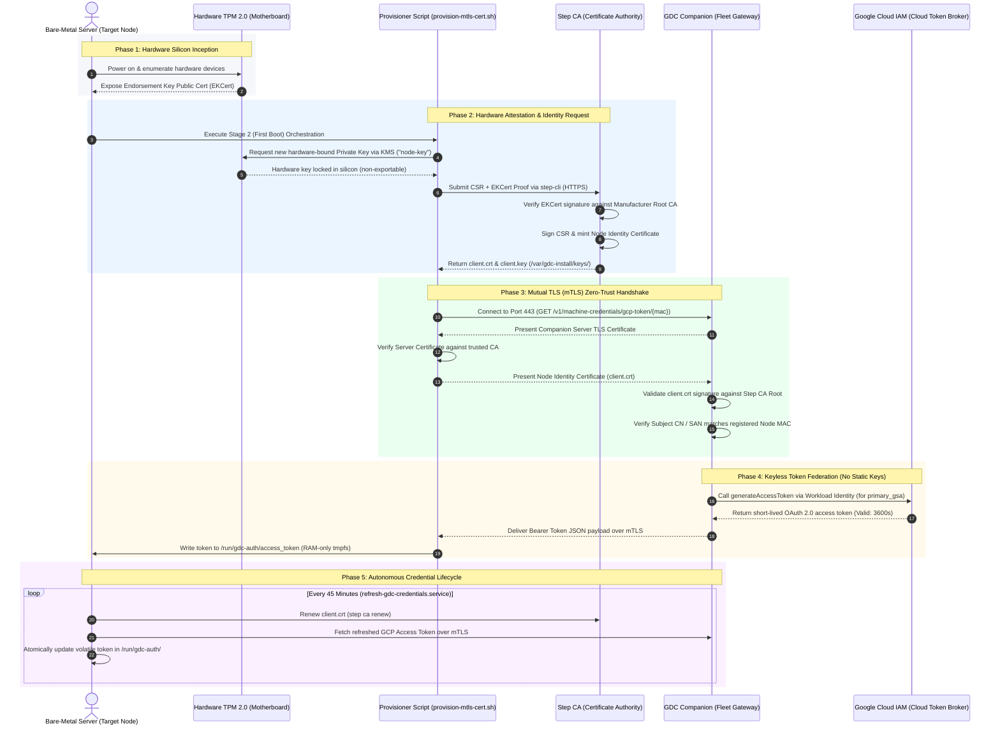

# Zero-Touch Hardware Attestation, mTLS, and GDC Companion Integration

This document explains how bare-metal servers in Google Distributed Cloud (GDC) prove their hardware authenticity, acquire cryptographically verifiable identities, and securely connect to the centralized fleet gateway (**GDC Companion**) without using static passwords or pre-shared secret keys.

It is designed for both **non-technical stakeholders** needing an intuitive understanding of the security architecture and **systems engineers** requiring precise implementation details regarding authentication, authorization, and cryptographic trust chains.

---

## 1. Executive Summary & Plain-English Analogy

When provisioning servers in remote, air-gapped, or edge locations, a fundamental challenge arises: **How can a central control system trust a machine that just powered on over the network?**

Traditional setups often rely on hardcoded administrator passwords, shared API keys, or pre-burned secrets on USB drives. These approaches present serious security risks—keys can be stolen, copied, leaked in code repositories, or extracted from compromised hard drives.

To eliminate this vulnerability, the GDC provisioner utilizes **Zero-Touch Hardware Attestation**:

### The "Digital Passport" Analogy

```text
┌─────────────────────────────────────────────────────────────────────────────────────────────┐
│                                     THE PASSPORT ANALOGY                                    │
│                                                                                             │
│  1. The Birth Certificate   │ The physical TPM 2.0 chip has an Endorsement Key Certificate  │
│     (EKCert)                │ (EKCert) permanently burned into its silicon at the factory.  │
│                             │ It proves the chip is genuine hardware, not a fake emulator.  │
│                             │                                                               │
│  2. The Passport Office     │ The server presents this hardware proof to our internal       │
│     (Step CA)               │ Certificate Authority (Step CA). The CA verifies the birth    │
│                             │ certificate and issues an official "Digital Passport"         │
│                             │ (an X.509 mTLS identity certificate).                         │
│                             │                                                               │
│  3. Border Control          │ When the server contacts the central gateway (GDC Companion), │
│     (mTLS Handshake)        │ both sides inspect each other's passports. Neither party      │
│                             │ will share any data until mutual identity is verified.        │
│                             │                                                               │
│  4. The Temporary Visitor   │ Once identity is verified, the Companion grants a temporary   │
│     Badge (Cloud Tokens)    │ 1-hour Google Cloud access token. No permanent cloud keys     │
│                             │ ever touch the server's hard drive.                           │
└─────────────────────────────────────────────────────────────────────────────────────────────┘
```

---

## 2. Core Concepts & Definitions

Understanding this process requires familiarizing oneself with five key elements:

| Component | What It Is (Simple Terms) | Technical Function |
| :--- | :--- | :--- |
| **TPM 2.0 (Trusted Platform Module)** | A tamper-proof cryptographic safe welded onto the computer motherboard. | Stores cryptographic keys in dedicated hardware. Private keys generated inside the TPM can never be read, copied, or exported into operating system memory. |
| **Endorsement Key Certificate (EKCert)** | The computer's factory-issued "birth certificate." | An X.509 certificate burned into the TPM during manufacturing by chipmakers (Infineon, Intel, STMicro, Nuvoton). Signed by the manufacturer's private root key. |
| **Step CA (Smallstep Certificate Authority)** | The internal "passport office" for the fleet. | An automated certificate authority that evaluates hardware proofs, validates CSRs (Certificate Signing Requests), and issues operational identity certificates to nodes. |
| **Mutual TLS (mTLS)** | A two-way secure conversation where both participants verify each other's IDs. | Unlike standard HTTPS (where only the client verifies the website), mTLS requires both the server and client to present valid certificates signed by trusted authorities. |
| **GDC Companion** | The centralized fleet manager and security gateway. | An edge coordination microservice written in Rust that manages machine configurations, receives audit logs, and brokers short-lived cloud credentials. |

---

## 3. High-Level Architecture & Communication Sequence

The diagram below illustrates the end-to-end lifecycle: from bare-metal cold boot to receiving short-lived Google Cloud Platform credentials.



---

## 4. Detailed Step-by-Step Breakdown

### Phase 1: Hardware Proof (The Silicon Root of Trust)

1. **Motherboard Initialization:** When the physical server powers on, the motherboard initializes the physical TPM 2.0 cryptographic chip.
2. **Factory Identity Extraction:** The TPM contains an immutable **Endorsement Key (EK)** and an associated **EKCert**. This certificate was cryptographically signed by the chipmaker (e.g., STMicroelectronics, Infineon, or Intel) before the chip left the factory.
3. **Impossibility of Cloning:** Because the private portion of the Endorsement Key is physically etched into silicon circuitry, it cannot be cloned, copied, or emulated by a rogue virtual machine.

---

### Phase 2: Hardware Attestation & Identity Issuance

Once the baseline operating system finishes writing to disk and reboots into **Stage 2 (First Boot)**, the provisioning script (`src/ansible/roles/machine_orchestration/files/provision-mtls-cert.sh`) executes:

1. **Hardware Key Generation:** The script uses `step-cli` with a TPM KMS plugin (`--kms="tpmkms:name=node-key"`). This commands the TPM to generate a brand-new cryptographic keypair directly inside the hardware chip. The private key never enters computer RAM and can never be stolen from disk.
2. **Certificate Request (CSR):** The script builds a Certificate Signing Request (CSR) containing the node's unique hardware identifier (primary MAC address and hostname).
3. **CA Proof Verification:** The request is sent to the local **Step CA** server. Step CA validates the request:
   * It verifies that the EKCert was signed by an approved TPM manufacturer CA.
   * It confirms the hardware measurements (Platform Configuration Registers) match an authentic system.
4. **Certificate Issuance:** Step CA signs the CSR and returns an official X.509 certificate:
   * **`client.crt`**: The public certificate identifying this exact machine.
   * **`client.key`**: The cryptographic key handle bound to the physical TPM.
   * Both files are saved under `/var/gdc-install/keys/` with restrictive file permissions (`0600` for the key, owned strictly by `root:root`).

---

### Phase 3: The Two-Way mTLS Handshake

When the node needs to communicate with the central orchestration service (**GDC Companion**), standard one-way encryption is insufficient. The system enforces **Mutual TLS (mTLS)** on port `443`:

1. **Server Proves Its Identity:** The node connects to `https://gdc-companion.domain:443`. The Companion presents its server certificate. The node validates this certificate against its local trusted CA bundle to ensure it is not speaking to an imposter or "man-in-the-middle."
2. **Node Proves Its Identity:** Before opening the data channel, the Companion demands: *"Show me your certificate."* The node presents `/var/gdc-install/keys/client.crt`.
3. **Zero-Trust Validation:** The Companion checks:
   * Did our trusted Step CA sign this certificate?
   * Has the certificate expired or been revoked?
   * Does the certificate's **Common Name (CN)** or **Subject Alternative Name (SAN)** match a known, registered machine in our database?
4. **Encrypted Session Established:** Only if both checks pass is an encrypted, mutually authenticated TLS tunnel established.

---

### Phase 4: Keyless Token Federation (Zero Static Keys)

Once the mTLS connection is verified, the node needs to interact with Google Cloud services (such as pulling container images, registering the cluster, or uploading audit logs). 

Rather than storing a permanent Google Service Account JSON key on the node's hard drive (which could be stolen if someone stole the physical drive), the system uses a **Keyless Profile**:

1. **Token Request:** Over the authenticated mTLS tunnel, the node calls:
   ```http
   GET /v1/machine-credentials/gcp-token/00:1a:2b:3c:4d:5e HTTP/1.1
   Host: gdc-companion.local
   ```
2. **Cloud Impersonation:** The GDC Companion (which runs with specialized Workload Identity permissions in Google Cloud) calls Google Cloud IAM:
   * It requests a temporary, volatile OAuth 2.0 bearer token for the specific service account assigned to that node.
3. **Short-Lived Delivery:** Google Cloud issues an access token valid for **1 hour (3600 seconds)**. The Companion sends this token over the mTLS tunnel back to the node.
4. **Volatile RAM Storage:** The node writes this token to:
   ```text
   /run/gdc-auth/access_token
   ```
   Because `/run` is a virtual memory filesystem (`tmpfs`), **this token never touches the physical hard drive**. If power is cut to the machine, the token instantly disappears.

---

### Phase 5: Autonomous Credential Lifecycle & Drift Prevention

To prevent disruption when tokens or certificates expire:

* **Certificate Renewal:** A background systemd service (`refresh-gdc-credentials.service`) wakes up every 45 minutes. It invokes `step ca renew` to rotate the client certificate before it expires.
* **Token Rotation:** The same service queries the Companion over mTLS, fetches a fresh 1-hour Google Cloud token, and atomically updates `/run/gdc-auth/access_token`.
* **Zero Disruption:** Cluster management tools (`bmctl`, `gcloud`, `kubectl`) read the freshly updated token seamlessly without requiring service restarts or node reboots.

---

## 5. Security Principles Enforced by this Architecture

### 1. Hardware-Enforced Authentication (Anti-Spoofing)
* **Threat:** An attacker connects a laptop or rogue virtual machine to the edge network and attempts to register as a legitimate cluster node.
* **Defense:** The rogue machine does not possess an authentic TPM 2.0 chip with an EKCert signed by an approved manufacturer. Step CA instantly rejects the certificate request, blocking network entry.

### 2. Strict Role-Based Authorization
* **Threat:** Machine A attempts to request configuration secrets or Google Cloud permissions belonging to Machine B.
* **Defense:** The GDC Companion cryptographically extracts the Common Name from the client certificate during the mTLS handshake. It only serves configurations and tokens explicitly mapped to that specific authenticated identity in the relational database.

### 3. Non-Exportable Private Keys
* **Threat:** A compromised operating system process attempts to read and exfiltrate private encryption keys.
* **Defense:** Because the client key is generated inside the hardware TPM cryptographic boundary (`tpmkms`), the private key bytes cannot be read by any software process, operating system kernel, or administrative user.

### 4. Zero Persistent Cloud Secrets (Ephemeral Credentials)
* **Threat:** A decommissioned or stolen server hard drive is examined for Google Cloud administrative credentials.
* **Defense:** No Google Cloud service account keys, passwords, or permanent API tokens are ever written to non-volatile storage. Decryption of the drive itself is locked to the physical motherboard's TPM, and runtime tokens exist only in volatile RAM.

---

## 6. Related Documentation & Specifications

* **Detailed Database Schema & Algorithmic Quote Checks:** [`docs/machine-database-requirements.md`](machine-database-requirements.md) (`GDC-SPEC-005`)
* **Token Federation API Contract:** [`docs/specs/10-gcloud-token-federation.md`](specs/10-gcloud-token-federation.md) (`GDC-SPEC-010`)
* **GDC Companion Architecture & Rust Stack:** [`docs/specs/07-gdc-companion-design.md`](specs/07-gdc-companion-design.md) (`GDC-SPEC-007`)
* **Physical Lab Setup & Step CA Configuration:** [`docs/LAB_SETUP.md`](LAB_SETUP.md)
* **Node Storage & Disk Encryption Specifications:** [`docs/DISKS.md`](DISKS.md) and [`docs/SECURITY.md`](SECURITY.md)
