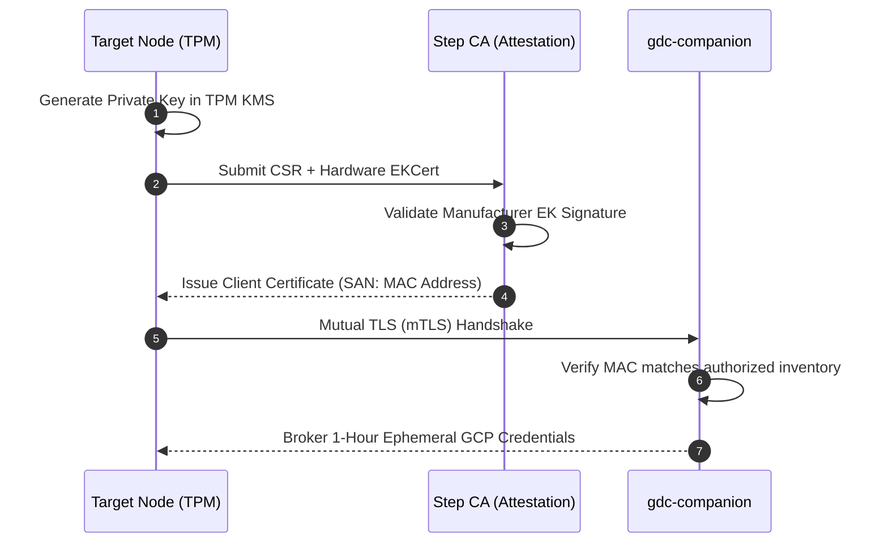

<!-- _class: lead -->

# Google Distributed Cloud (GDC) Software-Only Provisioning
### Autonomous Bare-Metal at the Edge

**Zero Console Intervention | Outage-Proof Architecture | Cryptographic Hardware Identity**

<!--
[VISUAL]: Title card showing Google Distributed Cloud brand motif, hardware rack illustration, and zero-touch edge provisioning badge.
[VOICEOVER]: Welcome to this comprehensive architectural overview of Google Distributed Cloud Software-Only Provisioning. In this session, we'll demonstrate how enterprise bare-metal servers can be autonomously deployed and operated in volatile edge environments with zero console typing, complete resilience to WAN failures, and cryptographic security rooted directly in hardware silicon.
[LIVE DEMO / TERMINAL CUE]: Display presentation title graphic and release version badge.
-->

---

## The Reality of the Edge: Broken Assumptions

* **Volatile WAN Connectivity:** Cellular, satellite, and branch MPLS links experience recurring dropouts, latency spikes, and multi-day blackouts.
* **Fragile Legacy Installers:** Traditional PXE setups and cloud-tethered installers fail immediately when external package repositories or central APIs become unreachable.
* **Smart Hands Bottleneck:** Dispatching technicians to type commands into serial consoles or recovery shells across hundreds of retail sites is slow, costly, and error-prone.
* **Configuration Drift:** Edge nodes diverge over time without continuous, deterministic drift reconciliation.

> **Key Takeaway:** Traditional data-center provisioning methodologies break down at the edge because they assume reliable cloud reachability.

<!--
[VISUAL]: Comparison split: Left shows a fragile cloud-dependent installer failing due to a dropped WAN connection; right shows an isolated edge store operating smoothly.
[VOICEOVER]: When deploying Kubernetes clusters to hundreds of retail stores, fulfillment hubs, or manufacturing plants, standard assumptions about data center connectivity collapse. WAN links drop, remote technicians are non-technical, and traditional PXE or cloud-tethered installers break halfway through when an external repository or metadata server vanishes.
[LIVE DEMO / TERMINAL CUE]: Highlighting edge outage statistics and showing connection timeout errors in traditional network boots.
-->

---

## Core Principle: Outage-First in Private Mode

* **Design for Total WAN Isolation:** Rather than treating network loss as an exception, we design for complete offline independence from the ground up.
* **Deterministic Local Boundaries:** If a physical node can boot, format, secure, and validate itself without a single external byte, network cuts become a non-event.
* **The Terminology Standard:** We strictly use **"Private Mode"**—never legacy or misleading terms. Private Mode defines completely self-contained local operations.
* **Zero Cloud Dependency During Turnup:** Cluster inception proceeds using strictly local, pre-seeded assets.

```
┌─────────────────────────────────────────────────────────────────────────┐
│                      PRIVATE MODE OPERATIONAL MANDATE                   │
├─────────────────────────────────────────────────────────────────────────┤
│ • Zero WAN reachability required for OS install or cluster turnup       │
│ • Local loopback service proxies (Gitea, Nexus) fulfill all requests    │
│ • Full cryptographic attestation via local TPM 2.0 without public CA    │
└─────────────────────────────────────────────────────────────────────────┘
```

<!--
[VISUAL]: Architecture diagram illustrating the "Private Mode" boundary, contrasting local loopback resolution with external WAN links marked with an outage symbol.
[VOICEOVER]: Our core architectural principle is simple: we design Outage-First in Private Mode. We deliberately avoid legacy or misleading terminology—we call this Private Mode. By treating total network isolation as the default baseline rather than an exceptional error state, a severed WAN cable during provisioning is a non-event. Everything required for the node to reach steady state exists inside its local boundary.
[LIVE DEMO / TERMINAL CUE]: Displaying network topology diagram showing node isolation with active internal traffic.
-->

---

## The Two Systems: Clear Demarcation of Concerns

The provisioning ecosystem is divided into two distinct, decoupled systems:

```
┌───────────────────────────────────┬───────────────────────────────────┐
│       gdc-disk-provisioner        │           gdc-companion           │
│         (The Node Engine)         │ (Day-0/Day-1 Config & Gateway)    │
├───────────────────────────────────┼───────────────────────────────────┤
│ • Custom Offline-First ISO Engine │ • Central Telemetry & Webhook Sink│
│ • UEFI Automated Bootloader Flip  │ • Ephemeral Boot ID & MAC Tracking│
│ • TPM 2.0 LUKS Disk Encryption    │ • Machine Configurations & Configs│
│ • Local Boundary (Gitea & Nexus)  │ • Step CA / mTLS Token Brokering  │
│ • 8-Stage Node State Machine      │ • Stage 5/6 Turnup Gating Endpoint│
│ • Autonomous Day-2 Upkeep         │ • Read-Only Provisioning Status   │
│   (systemd / ansible-pull / Gitea)│   (Note: NO Day-2 Fleet Ops/State)│
└───────────────────────────────────┴───────────────────────────────────┘
```

> **Architectural Boundary:** `gdc-companion` is strictly a Day-0/Day-1 configuration and attestation gateway. Day-2 runtime upkeep is **decentralized** directly on each node.

<!--
[VISUAL]: Two-column architectural card view contrasting gdc-disk-provisioner and gdc-companion with distinct Google Blue and Green color styling.
[VOICEOVER]: Clean separation of concerns is vital. gdc-disk-provisioner is the Node Engine. It handles the bare-metal silicon: Subiquity partitioning, TPM 2.0 sealing, loopback boundary services, and the 8-stage state machine. Meanwhile, gdc-companion serves as the Day-0 and Day-1 configuration, attestation, and provisioning gateway. Critically, gdc-companion does NOT perform Day-2 fleet management—Day-2 drift correction is completely decentralized and runs locally on each node via ansible-pull.
[LIVE DEMO / TERMINAL CUE]: Pointing out system demarcation line in architectural documentation.
-->

---

## The Persona Lens: Built for the Entire Fleet Team

| Persona | Role Scope | Primary Value Delivered |
| :--- | :--- | :--- |
| **Fleet / Platform Engineer** | Infrastructure & Cluster Lifecycle | Declarative bare-metal cluster turnup at scale; zero manual config or fragile PXE. |
| **Field Tech / Smart Hands** | Physical Site & Rack Deployment | Cable, power on, and walk away. Autonomous two-reboot provisioning without a keyboard. |
| **Platform Developer** | ISO & Systems Engineering | Fast local iteration via `build.sh`, `bootimus.py`, and reproducible lab targets. |
| **Support / Ops Analyst** | Monitoring & Triage ("Viewer") | Real-time webhook telemetry across boot cycles without requiring SSH access. |
| **SecOps & Compliance** | Zero-Trust & Auditability | Hardware-rooted TPM 2.0 EKCert, Step CA mTLS, LUKS sealing, and CIS Level 2 hardening. |

<!--
[VISUAL]: Matrix diagram showing the 5 enterprise personas with icons, highlighting their specific interactions with the provisioning flow.
[VOICEOVER]: No system exists in a silo. We built this platform through the lens of five core personas: Platform engineers get declarative cluster deployments. Smart hands technicians plug in cables and walk away without ever touching a keyboard. Developers get a lightning-fast inner loop with Bootimus. Support analysts get centralized telemetry webhooks. And SecOps gets uncompromised zero-trust security anchored in physical silicon.
[LIVE DEMO / TERMINAL CUE]: Highlighting the Field Tech and SecOps rows on the screen.
-->

---

## The 8-Stage Machine Overview


<!--
[VISUAL]: Full-width Mermaid flowchart rendering the 8 sequential stages matching the official repository README.md.
[VOICEOVER]: Here is the engine: an 8-stage deterministic state machine. Each stage guards the next, persisting state to NVMe disk and emitting telemetry back to gdc-companion. Notice how the machine seamlessly spans across two intentional reboot events between Stages 1, 2, and 3, ensuring proper hardware initialization before moving into cluster turnup.
[LIVE DEMO / TERMINAL CUE]: Tracing stage progression from Stage 1 through Stage 8.
-->

---

## Stages 1–3: Hardware Foundation

### Stage 1: LiveCD (ISO & Unattended Install)
* Boots custom live environment entirely into RAM; initializes hardware drivers.
* Subiquity executes dynamic disk partitioning (standard GDC LVM storage layout).
* Synchronizes offline Gitea repositories and Nexus package layers onto local target disks.

### Stage 2: First Boot (Services & TPM Sealing)
* Controlled reboot boots directly from installed NVMe drive.
* Launches containerized boundary services; binds disk encryption to motherboard **TPM 2.0**.
* Executes `efibootmgr` NVRAM flip to ensure the node never re-enters the installer.

### Stage 3: Second Boot (Auto-Unlock & Stability)
* Second reboot verifies unattended LUKS auto-decryption using hardware TPM keys.
* Confirms filesystem integrity and kernel stability before initiating cluster dependencies.

<!--
[VISUAL]: Multi-step hardware bootstrap diagram illustrating disk partitioning, TPM key sealing, and UEFI NVRAM order adjustment.
[VOICEOVER]: Stages 1 through 3 establish the hardware foundation. Stage 1 runs in memory from the custom ISO, laying down the official GDC LVM partition layout and seeding offline boundary assets. In Stage 2, the node reboots from NVMe, starts boundary containers, seals the LUKS encryption keys directly into the TPM 2.0 chip, and programmatically flips the UEFI NVRAM bootloader order. Stage 3 triggers an automated reboot to prove that the node unlocks unattended without human intervention.
[LIVE DEMO / TERMINAL CUE]: Console capture showing efibootmgr boot order output and systemd-cryptsetup TPM unsealing.
-->

---

## Stages 4–5: Boundary Services & Gating

### Stage 4: Linux Ready (Hardening & OS Dependencies)
* Enforces **CIS Level 2** benchmark configurations across kernel, sysctl, and SSH.
* Configures static VLAN networking, system limits, and kernel tuning parameters.
* Verifies local Nexus apt mirrors and container registry operational status.

### Stage 5: Cluster Ready (Config & NodeAgent Gating)
* Starts the local `node-agent` service; establishes mTLS connection with `gdc-companion`.
* Node transmits attestation proof (TPM EKCert) and retrieves site-specific cluster manifests.
* Node templates `/etc/hosts` and verifies internal name resolution.
* **Turnup Gating:** Evaluates cluster dependencies before allowing `bmctl` deployment.

```
Node (Stage 5)  ──[ mTLS + TPM EKCert ]──►  gdc-companion (Gateway)
Node (Stage 5)  ◄──[ Validated Config ]───  gdc-companion (Release Gate)
```

<!--
[VISUAL]: Sequence flow diagram between Node Stage 5 and gdc-companion demonstrating mTLS authentication and manifest retrieval.
[VOICEOVER]: Once the host OS is verified, Stages 4 and 5 bring up the boundary services. Stage 4 applies CIS Level 2 hardening benchmarks and network tuning. Stage 5 initializes node-agent, which establishes an authenticated mutual TLS session with gdc-companion using its hardware TPM identity. gdc-companion acts as a gatekeeper, validating the node's readiness and releasing its cluster configuration parameters.
[LIVE DEMO / TERMINAL CUE]: Terminal output showing step-cli certificate verification and node-agent handshake.
-->

---

## Stages 6–8: Cluster Inception & Day-2 Upkeep

### Stage 6: Cluster Turnup (Offline Cluster Inception)
* Executes `bmctl create cluster` in complete Private Mode isolation.
* Pulls container images and Kubernetes binaries strictly from the **127.0.0.1 loopback Nexus**.
* Provisions control plane, etcd quorum, Anthos Bare Metal components, and CNI.

### Stage 7: Post Cluster (Validation)
* Automated validation tests: Storage Classes, CoreDNS pods, and MetalLB VIP health.
* Confirms cluster readiness and marks provisioning complete in local state files.

### Stage 8: Upkeep (Decentralized Drift Management)
* Active runtime phase: periodic `systemd` timers trigger `ansible-pull`.
* Queries node-local **Gitea** Git repository to reconcile operational drift.
* Supports headless USB-drive sideload updates for software and security patches.

<!--
[VISUAL]: Split slide illustrating Stage 6 bmctl pulling from localhost Nexus, followed by Stage 8 ansible-pull syncing from localhost Gitea.
[VOICEOVER]: In Stage 6, cluster inception begins. bmctl creates the Kubernetes cluster without touching the internet, streaming container images directly from the local loopback Nexus cache. Stage 7 runs comprehensive health checks across CoreDNS, CNI, and storage. Finally, Stage 8 transitions the node to Day-2 operations. Notice that Day-2 drift control is decentralized: systemd triggers ansible-pull against the local Gitea instance on the node itself, completely immune to WAN outages.
[LIVE DEMO / TERMINAL CUE]: Showing successful bmctl output followed by ansible-pull convergence logs.
-->

---

## Enterprise Outcomes: Measured Impact

```
┌───────────────────────────────────┬───────────────────────────────────┐
│     Traditional Edge Deployments  │     Autonomous GDC Provisioning   │
├───────────────────────────────────┼───────────────────────────────────┤
│ • 4–8 hours per node with techs   │ • 25–35 minutes completely hands-off│
│ • Requires live WAN connectivity  │ • 100% resilient Private Mode     │
│ • Fragile PXE & TFTP timeouts     │ • Deterministic UEFI & local caches│
│ • Static passwords / manual keys  │ • Hardware-rooted TPM 2.0 & mTLS  │
│ • Central fleet server bottleneck │ • Decentralized Day-2 maintenance │
└───────────────────────────────────┴───────────────────────────────────┘
```

* **Zero Console Intervention:** Server boots, reboots twice, seals crypto, and turns up cluster.
* **Deterministic Reliability:** Identical turnup whether connected to 10 Gbps WAN or completely isolated.
* **Cryptographic Hardware Identity:** Silicon Endorsement Key eliminates credential forging.

<!--
[VISUAL]: High-contrast metric comparison table showing traditional deployment hurdles vs. autonomous GDC provisioning results.
[VOICEOVER]: The enterprise outcomes are dramatic. Turnup times drop from hours of error-prone manual console typing to under 35 minutes of hands-off automation. Nodes deploy identically whether on high-speed fiber or completely disconnected during an outage. And every server's identity is cryptographically rooted in silicon, creating an impenetrable security boundary for the edge.
[LIVE DEMO / TERMINAL CUE]: Highlight turnup time reduction and hands-off metric.
-->

---

<!-- _class: lead -->

# Part 2: Modular Deep-Dive Chapters
### Technical Walkthrough & Architecture Breakdown

<!--
[VISUAL]: Transition slide indicating the start of Part 2 modular technical chapters.
[VOICEOVER]: That concludes our high-level executive pitch. Now, let's step into the modular deep-dive chapters, exploring the technical mechanics across operations, developer workflows, observability, and zero-trust security.
[LIVE DEMO / TERMINAL CUE]: Chapter index graphic.
-->

---

## Chapter 1: The Operator Journey

### The Experience: "Cable, Power On, Walk Away"

```
[ Unbox Server ] ──► [ Connect Power & VLAN ] ──► [ Power On (Bootimus PXE / USB) ]
                             │
                             ▼
     ┌─────────────────────────────────────────────────────────┐
     │           AUTOMATED 2-REBOOT TURNUP SEQUENCE            │
     │  1. LiveCD Boot (Subiquity Partitioning & Seeding)      │
     │  2. First Boot (TPM Sealing & NVRAM Flip)               │
     │  3. Second Boot (Auto-Unseal & Cluster Turnup)          │
     └─────────────────────────────────────────────────────────┘
                             │
                             ▼
              [ Cluster Fully Operational in ~30 Min ]
```

* **No Keyboard or Monitor Required:** Zero interactive prompt stops.
* **Failure Safe:** Clear status signaling and telemetry reporting.

<!--
[VISUAL]: Step-by-step visual workflow illustrating the field operator experience from unboxing to cluster readiness.
[VOICEOVER]: For the field technician or smart hands operator, complexity is completely eliminated. The operator unboxes the server, connects power and networking, and boots the node. The two automated reboots happen behind the scenes, and within thirty minutes, the node is running a fully functional Kubernetes cluster without anyone touching a keyboard.
[LIVE DEMO / TERMINAL CUE]: Video clip of server booting and cycling through reboots automatically.
-->

---

## Operator Prerequisites & Turnup Lifecycle

### Network Handoff Strategy
* **Stage 1 Discovery:** Node requests transient DHCP lease to locate Bootimus PXE bootloader or boots directly from pre-baked offline USB.
* **Stage 2+ Static VLAN:** Subiquity writes hardened static IP, netmask, gateway, and VLAN tagging into netplan configurations.
* **DNS Resolution:** Local `/etc/hosts` managed dynamically by `node-agent` to eliminate DNS server dependencies.

### Provisioning Media Options
1. **Bootimus PXE Network Boot:** High-throughput TFTP/HTTP boot server in local lab or staging rack.
2. **Offline Provisioning USB:** Cryptographically verified USB flash drive containing full bootable ISO image.

<!--
[VISUAL]: Network transition diagram showing transient DHCP lease handoff to permanent static VLAN netplan configuration.
[VOICEOVER]: Behind the operator's seamless experience lies a structured networking lifecycle. During initial boot, nodes can leverage transient DHCP to acquire the bootloader or boot directly from offline USB media. Once Subiquity writes the configuration, the node transitions to static VLAN networking, locking down IP allocation and managing internal DNS locally to eliminate external dependencies.
[LIVE DEMO / TERMINAL CUE]: Displaying /etc/netplan configuration snippet generated by installer.
-->

---

## Chapter 2: The Developer Engine

### The Fast-Feedback Bare-Metal Inner Loop
* Developers working on OS images and hardware drivers need rapid cycle times on real silicon.
* The `gdc-disk-provisioner` repository provides an automated build and test loop:

```bash
# 1. Set environment parameters and target lab hardware
export TARGET_TEST_MACHINES="192.168.9.241 192.168.9.242 192.168.9.243"
export ENV="barn"
export VERSION="0.10.19"

# 2. Build customized bootable ISO with local caches
./build.sh --version "${VERSION}" --env barn --bootimus --yes

# 3. Direct Bootimus to next-boot the target servers into the new ISO
./src/build/bootimus.py --next-boot sync/gdc-labs-24.04-v${VERSION}-debug.iso --all-targets
```

<!--
[VISUAL]: Command-line terminal graphic demonstrating the build.sh invocation and bootimus.py target orchestration.
[VOICEOVER]: Platform engineers and kernel developers have access to a lightning-fast inner loop. Using build.sh and bootimus.py, an engineer can remaster a custom Ubuntu ISO with updated Subiquity configs, stage it on the Bootimus server, and command target lab servers to reboot into the new image—all with a single command pipeline.
[LIVE DEMO / TERMINAL CUE]: Terminal execution of ./build.sh followed by bootimus.py command output.
-->

---

## Developer Inner Loop: Mastering Hardware Quirks

### Real-World Bare-Metal Challenges
* **AMD Zen 4 PSP Contention:** Modern AMD server architectures can experience bus contention on the Platform Security Processor during early boot.
  * Solution: Targeted kernel command-line parameters (`modprobe.blacklist`) baked directly into ISO GRUB templates.
* **NVMe Controller Race Conditions:** Storage controller enumeration timing differences.
  * Solution: Deterministic udev rules and persistent WWN/UUID partition mapping.
* **UEFI NVRAM Variable Synchronization:**
  * Solution: Robust `efibootmgr` scripts to reorder boot entries and disable stale PXE fallback.

> **Engineering Principle:** Address silicon and motherboard quirks in software automation once, so field deployments run flawlessly every time.

<!--
[VISUAL]: Hardware block diagram showing AMD CPU, Platform Security Processor (PSP), TPM 2.0, and NVMe controller layout with applied mitigations.
[VOICEOVER]: Bare-metal engineering means mastering hardware quirks. On modern AMD Zen 4 architectures, for example, we mitigated Platform Security Processor bus contention by injecting kernel blacklist parameters into GRUB. We resolved NVMe timing races with deterministic UUID mapping, and automated UEFI NVRAM boot ordering using efibootmgr. Solving these low-level quirks upfront ensures field installations never hang.
[LIVE DEMO / TERMINAL CUE]: Highlighting kernel parameters in grub.cfg template.
-->

---

## Chapter 3: Observability & Health Monitoring

### Passive Observability Without Inbound Ports
* Edge firewalls block all inbound SSH and administrative ports.
* How do operations teams monitor turnup? **Outbound-only Webhook Telemetry.**

```
┌─────────────────┐                                  ┌───────────────────┐
│ Target Node     │                                  │   gdc-companion   │
│                 │  POST /api/v1/telemetry          │                   │
│ Stage 1 (LiveCD)├─────────────────────────────────►│ Telemetry Sink    │
│                 │  ?build_id=abc&mac=00:1a:2b...   │                   │
│ Stage 2 (Boot1) ├─────────────────────────────────►│ Webhook Ingestion │
│                 │                                  │                   │
│ Stage 5 (mTLS)  ├─────────────────────────────────►│ Stage Dashboard   │
└─────────────────┘                                  └───────────────────┘
```

<!--
[VISUAL]: Network flow diagram showing outbound HTTP/mTLS telemetry pings originating from edge nodes to central gdc-companion.
[VOICEOVER]: Observability in edge environments cannot rely on inbound SSH access. Instead, the node engine utilizes passive, outbound-only telemetry. As each stage executes, the node fires lightweight webhooks to gdc-companion, allowing central support teams to track turnup progress in real time without poking holes in edge firewalls.
[LIVE DEMO / TERMINAL CUE]: Live capture of webhook payloads arriving at gdc-companion dashboard.
-->

---

## Telemetry Protocol & State Inspection

### Correlating Boot Cycles via Hardware MAC
* Across Stage 1, 2, and 3 reboots, the ephemeral `build_id` changes per boot session.
* The constant anchor: **Physical MAC Address** of the primary NIC.
* gdc-companion correlates disparate boot sessions into a single node journey.

### Local Node State Files (`/var/gdc-install/state/`)
* Every stage transition writes an atomic, structured JSON state file:
  * `stage1_complete.json`
  * `stage2_tpm_sealed.json`
  * `stage6_cluster_created.json`
* Enables instantaneous local triage and automated root-cause analysis (RCA).

<!--
[VISUAL]: Diagram illustrating MAC address correlation across dynamic boot IDs, alongside JSON state file schema snippets.
[VOICEOVER]: Because the node reboots multiple times during provisioning, ephemeral session IDs change. We use the immutable hardware MAC address as the constant anchor to correlate all telemetry events into a single provisioning lifecycle. On the node itself, every transition is written as an atomic JSON state file under /var/gdc-install/state/, providing immediate local auditability.
[LIVE DEMO / TERMINAL CUE]: Viewing JSON state files on node filesystem: cat /var/gdc-install/state/stage2_tpm_sealed.json.
-->

---

## Chapter 4: Enterprise Security in Private Mode

### Zero-Trust Architecture Anchored in Silicon

```
┌────────────────────────────────────────────────────────────────────────┐
│                   TPM 2.0 HARDWARE ATTESTATION CHAIN                   │
├────────────────────────────────────────────────────────────────────────┤
│ 1. Silicon Birth Certificate: Manufacturer Endorsement Key (EKCert)   │
│ 2. Measured Boot: Platform Configuration Registers (PCRs 0, 2, 4, 7)  │
│ 3. Automated Step CA Enrollment: mTLS certificate with MAC SAN         │
│ 4. Unattended Disk Decryption: Sealed LUKS keys auto-unsealed by TPM   │
│ 5. Short-Lived Brokered Credentials: 1-hour temporary tokens           │
└────────────────────────────────────────────────────────────────────────┘
```

* **No Shared Secrets:** No static passwords or master root credentials stored on disk.
* **Silicon Binding:** Disks stolen from a server cannot be decrypted on another machine.

<!--
[VISUAL]: Layered security architectural diagram depicting hardware TPM 2.0, PCR registers, Step CA, and encrypted LUKS volume.
[VOICEOVER]: Security in Private Mode cannot rely on cloud identity providers. We establish zero-trust security directly in physical silicon. The server's manufacturer Endorsement Key Certificate acts as its immutable birth certificate. Platform Configuration Registers measure the boot integrity. If firmware, kernel, or bootloader are tampered with, the TPM refuses to release the LUKS disk encryption key.
[LIVE DEMO / TERMINAL CUE]: Running tpm2_nvread and tpm2_pcrread to inspect hardware attestation registers.
-->

---

## Hardware Attestation & mTLS Workflow



<!--
[VISUAL]: Mermaid sequence diagram showing the step-by-step mTLS enrollment handshake between the target node, Step CA, and gdc-companion.
[VOICEOVER]: Here is the automated attestation flow: The node generates a non-exportable private key within the TPM KMS and sends a Certificate Signing Request accompanied by its hardware EKCert to Step CA. Step CA validates the manufacturer signature and mints a client certificate containing the node's MAC address in the SAN. The node then performs a mutual TLS handshake with gdc-companion, which verifies the MAC against its inventory and brokers short-lived, 1-hour credentials.
[LIVE DEMO / TERMINAL CUE]: Trace sequence diagram steps 1 through 7 with pointer highlights.
-->

---

## Supply Chain Defense in Private Mode

### CIS Level 2 Hardening
* Automated remediation scripts enforce strict Center for Internet Security (CIS) benchmarks:
  * Restrictive file permissions and disabled legacy filesystems.
  * Hardened SSH daemon settings and core dump restrictions.
  * Auditd logging enabled for all administrative actions.

### Local Boundary Isolation
* **Loopback-Only Service Binding:** Gitea (port 3000) and Nexus (ports 8081, 5001) bind strictly to loopback (`127.0.0.1`) and private node interfaces.
* **No Outbound Leakage:** System packages, container images, and playbooks resolve exclusively within the authenticated local node perimeter.

<!--
[VISUAL]: Hardening badge icons displaying CIS Level 2 compliance and local loopback firewall boundaries.
[VOICEOVER]: Supply chain security is maintained through aggressive defense-in-depth. Every node is hardened to CIS Level 2 standards. Crucially, all boundary services—Gitea for Git playbooks and Nexus for container registries—are bound strictly to localhost loopback interfaces. There is zero outbound dependency leakage during cluster execution.
[LIVE DEMO / TERMINAL CUE]: Showing netstat / ss -tulpn output verifying services bound to 127.0.0.1.
-->

---

## The Deep-Dive Series Roadmap

This flagship presentation introduces the foundation. Explore our modular deep-dive sessions:

* **Episode 1: The Outage-Proof Edge**
  * Core architecture, Private Mode philosophy, and the 8-stage state machine.
* **Episode 2: The Zero-Touch Operator Experience** (`01-operator-guide.marp.md`)
  * Bootimus PXE setup, cabling, unattended reboots, and cluster deployment.
* **Episode 3: The Developer Inner Loop** (`02-developer-workbench.marp.md`)
  * ISO remastering, `build.sh`, Subiquity tuning, and hardware adaptations.
* **Episode 4: Telemetry & Edge Observability** (`03-observability-and-companion.marp.md`)
  * Webhook architecture, MAC correlation, state JSON inspection, and triage.
* **Episode 5: Zero-Trust Hardware Attestation & mTLS** (`04-architecture-and-security.marp.md`)
  * TPM 2.0 EKCert, Step CA enrollment, and short-lived credential brokering.

<!--
[VISUAL]: Grid roadmap highlighting all five episodes in the video and presentation series with preview thumbnails.
[VOICEOVER]: This flagship deck is your gateway to the entire architecture. For hands-on implementation details, join us in the upcoming deep-dive episodes where we explore operator workflows, developer remastering tooling, observability telemetry, and silicon-rooted zero-trust security.
[LIVE DEMO / TERMINAL CUE]: Displaying full series curriculum and episode schedule.
-->

---

<!-- _class: lead -->

## Summary & Repository Resources

### Autonomous Bare-Metal Edge Provisioning
* **Repository:** `gitlab.com/gcp-solutions-public/retail-edge/gdc-disk-provisioner`
* **Documentation:** `docs/ARCHITECTURE.md` & `docs/superpowers/specs/`
* **Companion Gateway:** `gdc-companion`

```
Ready to build? Run:
./build.sh --version <version> --env barn --bootimus --yes
```

<!--
[VISUAL]: Closing slide with repository links, documentation references, QR codes, and Google Cloud Distributed Cloud brand mark.
[VOICEOVER]: Thank you for watching. With gdc-disk-provisioner and gdc-companion, enterprise bare-metal edge deployments are autonomous, resilient to outages, and cryptographically secure. Check out the documentation and build scripts in our repository to get started today.
[LIVE DEMO / TERMINAL CUE]: Final terminal prompt returning to clean prompt.
-->
