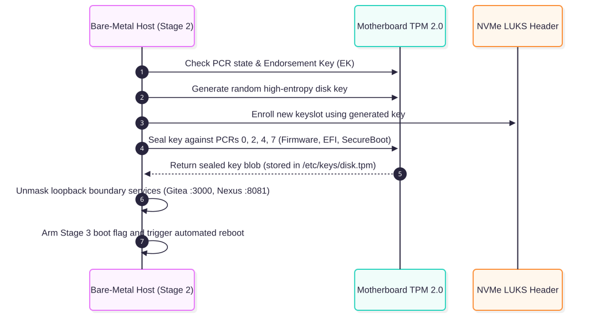

<!-- _class: lead -->

# GDC Operator Deep Dive
### Zero-Touch Bare-Metal Turnup & Operations

**Private Mode Autonomous Turnup | Smart Hands Workflow | Decentralized Day-2 Upkeep**

<!--
[VISUAL]: Title card with Google Distributed Cloud brand styling, showing bare-metal rack servers, an operator terminal, and the Zero-Touch Turnup badge.
[VOICEOVER]: Welcome to the GDC Operator Deep Dive. In this session, we cover the end-to-end operational lifecycle for Google Distributed Cloud Software-Only bare-metal deployments in Private Mode. We will walk through everything from physical racking and cabling by on-site Smart Hands to automated multi-reboot provisioning, cluster inception, and decentralized Day-2 drift management.
[LIVE DEMO / TERMINAL CUE]: Display presentation title graphic and operator terminal session.
-->

---

## The Operator Personas: Division of Responsibilities

Effective operations at scale require an unmistakable division of labor between site technicians and platform engineering:

| Dimension | Smart Hands / Field Tech (On-Site Physical) | Fleet / Platform Engineers (Remote Architecture) |
| :--- | :--- | :--- |
| **Physical Scope** | Racking, power cabling, redundant NIC patching, out-of-band IPMI setup | Declarative cluster specs, CIDR allocations, network profiles |
| **Console Access** | **Strictly None Required.** No monitor, crash cart, or serial cable needed | Remote Git repository management, `gdc-companion` templates |
| **Tooling & Media** | Bootimus PXE boot or pre-flashed USB thumb drives | `build.sh` pipeline, `gdc-companion` attestation service, GitOps repos |
| **Turnup Action** | Power on chassis, verify LED link lights, confirm completion beep/status | Monitor webhooks, observe cluster validation, gate workload rollout |
| **Failure Handling** | Power cycle or trigger USB fallback if physical link fails | Inspect telemetry artifacts, analyze `/var/gdc-install/state/*.json` |

> **Operational Principle:** Smart Hands should never need a crash cart or keyboard. The system must boot, partition, seal, and orchestrate autonomously.

<!--
[VISUAL]: Two-column persona breakdown contrasting an on-site field technician connecting network cables with a remote platform engineer managing declarative Git manifests.
[VOICEOVER]: Operating edge infrastructure at scale demands strict separation of concerns. On-site Smart Hands technicians handle physical logistics: racking the chassis, connecting dual power feeds, patching network interfaces, and applying power. They never need a crash cart, serial cable, or keyboard. Remote Platform Engineers own the declarative configurations: IP subnets, VLAN allocations, and cluster manifests. Once the physical server powers on, the software takes full control.
[LIVE DEMO / TERMINAL CUE]: Highlight the contrast in the table between zero console requirements for Smart Hands versus declarative GitOps management for Fleet Engineers.
-->

---

## Physical Site Requirements & Cabling

Before applying power, ensure the physical environment meets the bare-metal hardware baseline:

* **Out-of-Band Management (OOB):**
  * Dedicated 1GbE IPMI / iLO / iDRAC interface connected to isolated management subnet.
  * Static IP or reserved DHCP for remote BMC power cycling and virtual media fallback.
* **Production Network Interfaces (NICs):**
  * **Primary NIC (`eth0` / `eno1`):** Connected to access port for Stage 1 untagged DHCP discovery, trunking VLANs in Stage 4+.
  * **Secondary NIC (`eth1` / `eno2`):** Redundant interface for active-backup bonding (LACP or 802.3ad) in high-availability profiles.
* **Power & Silicon Pre-requisites:**
  * Redundant A/B power supplies connected to diverse PDU circuits.
  * Motherboard TPM 2.0 cryptoprocessor enabled in UEFI, with AMD SEV/PSP or Intel TXT configured.
* **Provisioning Ingestion Options:**
  * **Primary:** Bootimus iPXE boot over local broadcast network.
  * **Fallback Option:** High-speed USB 3.0 flash drive (FAT32 EFI partition + raw LiveCD ISO payload).

<!--
[VISUAL]: Server rear panel diagram identifying dual power inlets, dedicated IPMI RJ45 port, primary and secondary 10/25GbE SFP28/RJ45 NICs, and front-panel USB 3.0 slot.
[VOICEOVER]: Prior to turnup, field technicians verify physical cabling. The dedicated out-of-band IPMI interface sits on a management subnet for remote power control. The primary production NIC connects to an access switch port configured initially for untagged DHCP, which later accepts tagged VLAN trunking. Dual power feeds connect to diverse PDUs, and the motherboard UEFI must have TPM 2.0 active. For provisioning delivery, Bootimus PXE is the standard route, with offline USB flash media available as an immediate fallback.
[LIVE DEMO / TERMINAL CUE]: Trace cabling path from server NIC ports to top-of-rack switches on rear server diagram.
-->

---

## Network Architecture: Stage 1 DHCP to Stage 2+ VLAN Trunking



* **Stage 1 (Bootstrap):** Requires simple untagged DHCP for iPXE chaining and LiveCD kernel bootstrapping.
* **Stage 2+ (Installed OS):** Netplan configures static addressing or tagged VLAN interfaces directly on the host.
* **Private Mode Boundary:** No internet routing required; all HTTP/PXE endpoints reside within the local rack or broadcast domain.

<!--
[VISUAL]: Network flow diagram showing transition from Stage 1 untagged DHCP broadcast to Stage 2+ tagged VLAN trunking with dedicated management and MetalLB VIP subnets.
[VOICEOVER]: Network transitions during provisioning must be seamless. During Stage 1, the bare-metal node requires simple untagged DHCP broadcast access to obtain an ephemeral IP and fetch the Bootimus iPXE payload. Once Subiquity writes the hardened OS to disk, it provisions Netplan configurations for Stage 2 onwards. From that moment forward, the node operates across tagged VLANs—for instance, VLAN 100 for node control plane traffic and VLAN 200 for MetalLB ingress—all bound strictly within the local Private Mode network.
[LIVE DEMO / TERMINAL CUE]: Show tcpdump capture illustrating transition from DHCP DISCOVER to tagged 802.1Q frames.
-->

---

## PXE Infrastructure with Bootimus

`Bootimus` provides a lightweight, self-contained iPXE and HTTP service tailored for edge bare metal:

```ini
# /etc/bootimus/ipxe/boot.ipxe menu excerpt
#!ipxe
kernel http://192.168.1.5:8080/tftp/vmlinuz ip=dhcp url=http://192.168.1.5:8080/iso/gdc-node.iso \
  autoinstall ds=nocloud-net;s=http://192.168.1.5:8080/autoinstall/ \
  console=tty0 console=ttyS0,115200n8 quiet ---
initrd http://192.168.1.5:8080/tftp/initrd
boot
```

* **Zero Cloud Dependency:** Bootimus serves the kernel, initrd, Subiquity user-data, and raw ISO directly from local storage.
* **Dynamic Node Targeting:** Selects target ISO and kernel parameters based on client MAC address matching.
* **Serial Console Mirroring:** Kernel parameters multiplex output to both physical display (`tty0`) and serial IPMI (`ttyS0,115200n8`).
* **Operator Command:** Verify service readiness using `systemctl status bootimus` or query active MAC endpoints via HTTP API.

<!--
[VISUAL]: Architecture diagram of Bootimus container hosting DHCP proxy, TFTP daemon, and Nginx HTTP static file server, serving iPXE boot files to edge nodes.
[VOICEOVER]: Bootimus is our dedicated local deployment server for edge environments. It bundles TFTP, iPXE scripting, and an HTTP server that streams the remastered LiveCD ISO and Subiquity autoinstall configurations. Notice the kernel command line: it passes the nocloud-net datasource pointing to local HTTP endpoints, sets up serial console redirection to ttyS0 for out-of-band capture, and requires zero external WAN reachability.
[LIVE DEMO / TERMINAL CUE]: Terminal showing systemctl status bootimus followed by curl to inspect the generated iPXE menu.
-->

---

## The Automated Turnup Sequence: Power-On to Production

When power is applied to bare-metal hardware, the 8-stage state machine executes autonomously:

```
[Power Applied / BMC Power On]
       │
       ▼
[Stage 1: LiveCD Installation] ──► Subiquity partitions NVMe, formats LVM, drops Stage 2 payload
       │
       ▼ (Reboot 1: Automated UEFI Flip to Primary NVMe)
[Stage 2: First Boot]          ──► TPM 2.0 seals LUKS key, unmasks local boundary services (Gitea/Nexus)
       │
       ▼ (Reboot 2: Verification of Unattended Boot)
[Stage 3: Second Boot]         ──► Verifies automatic TPM unseal without passphrase or prompt
       │
       ▼
[Stage 4: Network & Sideload]  ──► Applies static VLAN Netplan; mirrors container images to loopback
       │
       ▼
[Stage 5: Cluster Readiness]   ──► Attests TPM identity; gates turnup with gdc-companion
       │
       ▼
[Stage 6: Cluster Inception]   ──► Executes bmctl create cluster from offline loopback registries
       │
       ▼
[Stage 7: Validation]          ──► Sanity tests CoreDNS, MetalLB VIPs, local StorageClasses
       │
       ▼
[Stage 8: Autonomous Day-2]    ──► gdc-provision.timer runs periodic local ansible-pull reconciliation
```

<!--
[VISUAL]: Flowchart detailing the full sequence across Stage 1 through Stage 8, highlighting the two deliberate automated reboots between Stages 1, 2, and 3.
[VOICEOVER]: Here is the complete automated turnup sequence when power is applied. Stage 1 boots the LiveCD and formats the drives via Subiquity. The node then executes its first automated reboot into the installed OS for Stage 2, where it seals the LUKS encryption key into TPM 2.0 silicon. It then reboots a second time for Stage 3 to mathematically prove that unattended unlock works. Once validated, it configures static VLANs, gates readiness, deploys the Kubernetes cluster via bmctl, and transitions into Day-2 autonomous upkeep.
[LIVE DEMO / TERMINAL CUE]: Trace cursor down the flowchart highlighting Reboot 1 and Reboot 2 transitions.
-->

---

## Stage 1 (LiveCD): Subiquity Autoinstall & Partitioning

Stage 1 runs in an ephemeral in-memory environment, laying down the encrypted OS layout:

* **Automated Drive Wipe & NVMe Layout:**
  * Wipes target drive `/dev/nvme0n1` and establishes GPT partition table.
  * `nvme0n1p1`: EFI System Partition (`/boot/efi`, 1GB, FAT32).
  * `nvme0n1p2`: Boot Partition (`/boot`, 2GB, ext4, unencrypted).
  * `nvme0n1p3`: Encrypted LUKS volume (`dm-crypt` container).
* **LVM Volume Group Structure (`vg_root`):**
  * `lv_root`: Root filesystem (`/`, 50GB, ext4).
  * `lv_var`: System logs & runtimes (`/var`, 100GB, ext4).
  * `lv_storage`: GDC containers & persistent storage (`/var/lib/anthos`, remainder).
* **First Phone-Home Webhook:**
  * Curated `early-commands` and `late-commands` execute webhook callbacks to `gdc-companion`.
  * Drops transient `stage1-complete.json` marker and flips UEFI boot order to primary NVMe disk.

<!--
[VISUAL]: Storage partition breakdown showing nvme0n1 layout: EFI, unencrypted boot, and LUKS-encrypted physical volume hosting LVM logical volumes for root, var, and Anthos storage.
[VOICEOVER]: In Stage 1, Subiquity autoinstall takes over the LiveCD environment. It wipes the designated NVMe disk and partitions it cleanly: a 1GB EFI partition, a 2GB unencrypted boot partition, and an encrypted LUKS container consuming the rest of the drive. Inside LUKS, an LVM volume group isolates root, system logs, and GDC cluster storage. In late-commands, a phone-home webhook fires to gdc-companion, drops state markers, and changes the UEFI boot order before triggering the first reboot.
[LIVE DEMO / TERMINAL CUE]: Terminal output showing lsblk and pvs/vgs/lvs hierarchy during Subiquity installation.
-->

---

## The First Reboot & Stage 2: TPM 2.0 LUKS Sealing



* **Cryptographic Anchor:** Disk encryption keys are permanently bound to the server's physical motherboard silicon.
* **Tamper Proofing:** If an attacker extracts the NVMe drive or alters UEFI firmware, PCR measurements diverge and decryption fails.
* **Local Service Boundary:** Stage 2 extracts pre-bundled packages and seeds local loopback mirrors.

<!--
[VISUAL]: Sequence diagram illustrating communication between the host OS kernel, motherboard TPM 2.0 chip, and LUKS header during key enrollment and PCR binding.
[VOICEOVER]: The first reboot brings the server into Stage 2. Here, the node seals its own encryption key into the motherboard's TPM 2.0 chip. The key is cryptographically bound to Platform Configuration Registers measuring BIOS firmware, boot code, and Secure Boot state. If the physical drive is stolen or if UEFI firmware is compromised, the TPM refuses to release the key. Stage 2 also initializes the local loopback boundary services before triggering the second reboot.
[LIVE DEMO / TERMINAL CUE]: Terminal execution of tpm2_pcrread and clevis luks list command outputs.
-->

---

## The Second Reboot & Stage 3: Verifying Unattended Boot

Why execute a second reboot? In edge operations, automated verification is mandatory:

* **The Problem with "Blind Trust":**
  * Sealing a key to TPM during an active session does not prove the system can reboot unattended.
  * If initramfs lacks TPM drivers, Clevis fails, or PCRs mismatch, the node hangs at `Enter passphrase:` prompt.
* **Stage 3 Verification Protocol:**
  * The node reboots cleanly from power management.
  * GRUB loads the kernel and initramfs from `/boot`.
  * `systemd-cryptsetup` / Clevis queries TPM 2.0 via `/dev/tpmrm0`.
  * The TPM verifies PCR integrity and releases the key; `/dev/mapper/vg_root-lv_root` mounts without user intervention.
* **State Emission:**
  * Post-boot systemd service validates unattended unlock time (< 4 seconds).
  * Emits `stage3-unlock-verified.json` state telemetry to local storage and remote webhook.

> **Operator Assurance:** If Stage 3 succeeds, Smart Hands can guarantee the node will survive future power outages safely.

<!--
[VISUAL]: Split screen showing a traditional server stalled waiting for a console passphrase versus the GDC node unlocking its LUKS volume unattended in under 3 seconds.
[VOICEOVER]: Why do we require a second reboot? Because in edge environments, blind trust leads to truck rolls. Sealing a key to TPM in an active session does not guarantee that the next cold boot will succeed. If the initramfs lacks the required TPM drivers, the server hangs forever on a password prompt. Stage 3 deliberately reboots the machine to verify that Clevis and systemd unlock the encrypted drive in under 4 seconds without human intervention.
[LIVE DEMO / TERMINAL CUE]: Serial console log replay demonstrating kernel initramfs unlocking LUKS without interactive prompts.
-->

---

## Stages 4 & 5: Static VLAN Migration & Readiness Gating

Once disk security is validated, the node configures enterprise networking and checks in:

### Stage 4: Production Network Activation
* **VLAN Configuration:** Netplan tears down temporary DHCP leases and binds production static IPs on tagged VLANs.
* **Loopback Image Warming:** Docker/Containerd loads pre-seeded GDC container tarballs into local cache.
* **Network Isolation Check:** Confirms that local host processes communicate strictly with `127.0.0.1:8081` (Nexus) and `127.0.0.1:3000` (Gitea).

### Stage 5: Cluster Readiness Gating with `gdc-companion`
* **mTLS Attestation:** Node presents its hardware certificate (derived from TPM EKCert) to `gdc-companion`.
* **Parameter Validation:** Validates node IP, gateway route, DNS resolution, and NTP synchronization against cluster manifest.
* **Green-Light Barrier:** `gdc-companion` evaluates the node's health and returns `PROVISIONING_AUTHORIZED` token.

<!--
[VISUAL]: Diagram depicting Stage 4 Netplan network reconfiguration to static VLAN, followed by Stage 5 mTLS handshake between node and gdc-companion gateway.
[VOICEOVER]: With security locked in, Stages 4 and 5 bring up the production environment. In Stage 4, Netplan transitions the host from temporary DHCP to tagged static VLAN interfaces. Container images are pre-warmed into containerd from local disk. In Stage 5, the node attests its identity to gdc-companion using hardware certificates. The companion verifies network parameters, clock synchronization, and node readiness before giving the green light for cluster inception.
[LIVE DEMO / TERMINAL CUE]: Terminal view showing netplan apply execution followed by curl validation of the gdc-companion health check endpoint.
-->

---

## Stage 6: Cluster Inception via `bmctl` in Private Mode

With prerequisites verified, the node initiates bare-metal Kubernetes deployment:

```bash
# Executed automatically by create_cluster.sh in Stage 6
bmctl create cluster -c ${CLUSTER_NAME} \
  --registry-mirror http://127.0.0.1:5001/ \
  --v=2
```

* **Local Private Registry:** All Kubernetes control plane images (`kube-apiserver`, `etcd`, Anthos agents) stream directly from loopback Nexus on port `5001`.
* **Local GitOps Upstream:** Initial cluster blueprints, CRDs, and Config Sync packages pull from loopback Gitea (`http://127.0.0.1:3000/gdc/manifests.git`).
* **Zero WAN Dependence:** Even if the site WAN link is completely severed, cluster inception completes in ~12 minutes.
* **State Checkpointing:** Real-time log scraping streams step milestones (`bootstrap-cluster-created`, `control-plane-healthy`) to `/var/gdc-install/state/cluster-turnup.json`.

<!--
[VISUAL]: System architecture during bmctl execution showing bmctl communicating with local loopback Nexus on port 5001 and Gitea on port 3000 to bootstrap Kind and install the control plane.
[VOICEOVER]: Stage 6 is the inception of the Kubernetes cluster. bmctl create cluster executes automatically using an offline cluster manifest. Notice the registry mirror flag: it targets the local Nexus repository on loopback port 5001. Similarly, GitOps manifests are pulled from local Gitea on port 3000. Even if external WAN connectivity is entirely disconnected, cluster turnup completes deterministically in roughly 12 minutes.
[LIVE DEMO / TERMINAL CUE]: Terminal output displaying bmctl create cluster progress bars and Pod readiness milestones.
-->

---

## Stage 7 & Validation: Comprehensive Cluster Sanity Tests

Before declaring turnup complete, automated validation tests verify core cluster subsystems:

```
┌────────────────────────────────────────────────────────────────────────┐
│                   STAGE 7 AUTOMATED VALIDATION SUITE                   │
├───────────────────────┬────────────────────────────────────────────────┤
│ Subsystem             │ Verification Action & Success Criteria         │
├───────────────────────┼────────────────────────────────────────────────┤
│ Control Plane Health  │ kubectl get nodes -o wide (Status: Ready)      │
│ Internal DNS          │ CoreDNS resolve test: kubernetes.default.svc   │
│ Load Balancer         │ MetalLB ARP announcement on VLAN 200 VIP       │
│ Persistent Storage    │ Dynamic PVC binding with local CSI provisioner │
│ Config Sync Reconciler│ RootSync & RepoSync status: SYNCED             │
└───────────────────────┴────────────────────────────────────────────────┘
```

* **Self-Healing Checks:** If any sanity test fails, automated retry logic executes targeted reconciliations.
* **Audit Trail Generation:** Test outputs compile into `/var/gdc-install/state/validation-report.json`.
* **Operator Notification:** Fires final completion webhook to `gdc-companion` and sounds chassis motherboard completion chime.

<!--
[VISUAL]: Verification dashboard matrix showing green checkmarks across Nodes, CoreDNS, MetalLB VIP announcement, CSI Persistent Volumes, and Config Sync status.
[VOICEOVER]: Before marking the node operational, Stage 7 runs an automated validation suite. It checks that all Kubernetes control plane nodes report Ready, confirms CoreDNS resolves internal cluster domains, validates that MetalLB announces Layer 2 ARP addresses on the workload VLAN, tests CSI storage volume mounting, and verifies Config Sync synchronization. Once all tests pass, a final webhook signals completion and the node emits an audible completion tone.
[LIVE DEMO / TERMINAL CUE]: Terminal running kubectl get nodes, get pods -A, and executing validation verification script.
-->

---

## Stage 8: Autonomous Day-2 Drift Management via `ansible-pull`


* **Decoupled from `gdc-companion`:** `gdc-companion` is strictly a Day-0/Day-1 configuration and attestation gateway. It does **not** manage Day-2 fleet runtime state.
* **Decentralized Local Upkeep:** Each node runs `systemd/gdc-provision.timer` locally, triggering `ansible-pull` against its local or synchronized Git repository.
* **Outage-Resilient Drift Correction:** If an operator manually modifies firewall rules, file permissions, or services, the node autonomously corrects the drift offline.
* **Zero WAN Heartbeat Blockers:** Nodes continue enforcing CIS Level 2 compliance and configuration hygiene during extended WAN outages.

<!--
[VISUAL]: Flowchart illustrating systemd gdc-provision.timer triggering local ansible-pull execution against the node's local Git repository, with zero dependency on external controllers.
[VOICEOVER]: A critical architectural principle of our platform: Day-2 drift management is completely decentralized. gdc-companion is strictly a Day-0 and Day-1 gateway. It does not manage Day-2 state. Instead, each node runs an autonomous systemd timer every 15 minutes that executes ansible-pull locally. If someone alters firewall rules or packages, the node self-remediates immediately—even during a multi-week WAN outage.
[LIVE DEMO / TERMINAL CUE]: Terminal showing systemctl list-timers gdc-provision.timer and running an ad-hoc ansible-pull run to demonstrate drift correction.
-->

---

## Operational Runbook: Diagnosing Stalls & Node Resets

When a bare-metal turnup does not progress as expected, follow this standard triage runbook:

### 1. Inspecting Local State Artifacts
All phase transitions persist human-readable state in `/var/gdc-install/state/`:
* `cat /var/gdc-install/state/<stage>.json`: (e.g. `cluster-turnup.json`, `linux-ready.json`) Shows timestamps, status, step milestones, and error records.

### 2. Live Journal Inspection
* `journalctl -u gdc-provision -f`: Follows the active orchestrator workflow.
* `tail -f /var/log/create-cluster.log`: Monitors underlying Kubernetes cluster turnup progress.

### 3. Clean Node Reset Procedure
If a node must be reprovisioned from scratch:
```bash
# Remote operator workstation reset:
./bin/local/gdc-node-ops.sh reset-pxe --nodes <NODE_IP> --iso <ISO_PATH>

# Local node manual restart:
sudo rm -f /var/gdc-install/state/cluster-ready.json
sudo systemctl restart gdc-provision.service
```
* Reconfigures UEFI `BootNext` via `efibootmgr` to force next boot from Bootimus PXE.

<!--
[VISUAL]: Diagnostic terminal display showing jq queries on /var/gdc-install/state/cluster-turnup.json, journalctl logs, and the clean node reset command execution via gdc-node-ops.sh.
[VOICEOVER]: Even in automated systems, operators need clear diagnostic runbooks. If a node appears stalled, the first place to look is /var/gdc-install/state/. Every stage writes structured JSON files capturing timestamps, retry counts, and step milestones. Operators can tail journalctl for gdc-provision or review create-cluster.log. If a clean restart is needed, run gdc-node-ops.sh reset-pxe from your workstation, which configures the UEFI BootNext variable to restart the sequence cleanly from Bootimus PXE.
[LIVE DEMO / TERMINAL CUE]: Terminal demo showing jq . /var/gdc-install/state/cluster-turnup.json followed by ./bin/local/gdc-node-ops.sh --help.
-->

---

## Summary & Key Operator Takeaways

```
┌────────────────────────────────────────────────────────────────────────┐
│                        CORE OPERATIONAL RULES                          │
├────────────────────────────────────────────────────────────────────────┤
│ 1. Zero Console for Smart Hands: Cable, power on, and walk away.       │
│ 2. The Double Reboot is Intentional: Reboot 1 seals TPM; Reboot 2      │
│    proves unattended LUKS unlock without human intervention.           │
│ 3. True Private Mode: Complete turnup proceeds with zero WAN reach.    │
│ 4. Clear Demarcation: gdc-companion is Day-0/1 gateway only; Day-2     │
│    drift upkeep is strictly decentralized via local ansible-pull.      │
│ 5. State-Driven Troubleshooting: Inspect /var/gdc-install/state/       │
│    before touching physical chassis hardware.                          │
└────────────────────────────────────────────────────────────────────────┘
```

* **Documentation:** `docs/operations/operator-playbook.md`
* **Repository:** `https://github.com/google/gdc-disk-provisioner`
* **Telemetry Endpoints:** `http://<gdc-companion-host>:8080/api/v1/telemetry`

<!--
[VISUAL]: Summary slide displaying the 5 core operational rules in a highlighted card, flanked by links to documentation and telemetry endpoints.
[VOICEOVER]: To summarize: Smart Hands technicians need zero console access—cable the server, power it on, and let the state machine run. The two reboots are by design: the first seals TPM encryption, and the second proves unattended unlock works. Everything runs in Private Mode without WAN reliance. Day-2 drift management is strictly decentralized on the node, not governed by gdc-companion. And when diagnosing issues, check /var/gdc-install/state/ before touching the chassis. Thank you.
[LIVE DEMO / TERMINAL CUE]: Display summary card and highlight repository documentation links.
-->