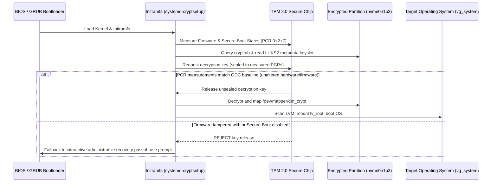
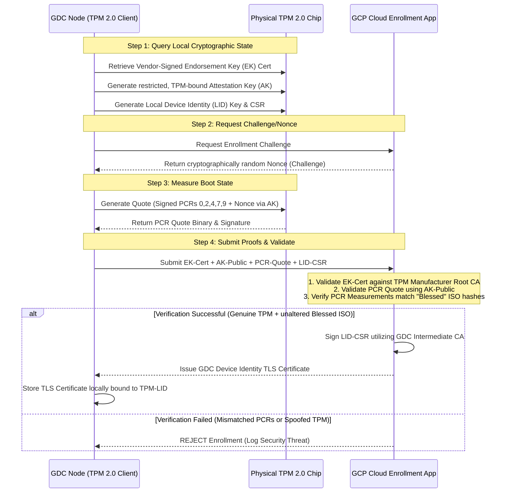
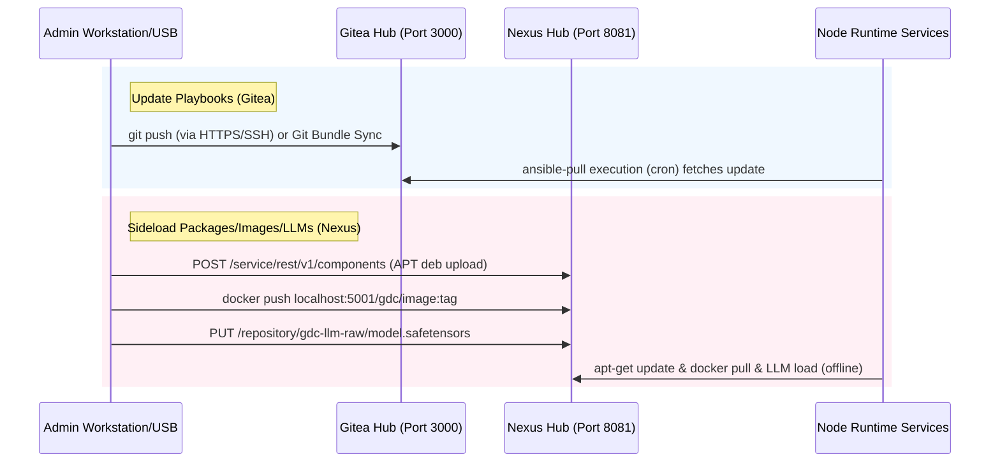

# Specification: GDC Ready-Linux Provisioning & Sideloading Interface

**Spec Identifier:** `GDC-SPEC-003`  
**Status:** DRAFT  
**Author:** GDC Disk Provisioner Architecture Team  

---

## 1. Overview & Purpose
This specification governs the transitioning from a baseline OS install to a "Ready-Linux" node, configuring administrative identities, persistent Gitea & Nexus boundary service hubs, hardware cryptography (TPM 2.0), security hardening, and standard offline update/sideloading procedures.

---

## 2. The First-Boot Migration & Service Transition
During the final moments of Subiquity installation (`late-commands`), the pre-loaded Gitea/Nexus services and data stores are cloned from the read-only live media into the newly configured LVM partitions on the target system.

### 2.1. Late-Command Sync Script
```yaml
autoinstall:
  late-commands:
    # 1. Mount the persistent Gitea and Nexus logical volumes
    - mkdir -p /target/var/lib/gitea /target/var/lib/nexus
    
    # 2. Extract and sync data from CD-ROM to persistent partitions
    - rsync -a --info=progress2 /cdrom/custom-data/gitea/ /target/var/lib/gitea/
    - rsync -a --info=progress2 /cdrom/custom-data/nexus/ /target/var/lib/nexus/
    
    # 3. Deploy persistent systemd configurations
    - cp /cdrom/custom-data/systemd/gitea.service /target/etc/systemd/system/
    - cp /cdrom/custom-data/systemd/nexus.service /target/etc/systemd/system/
    - curtin in-target -- systemctl enable gitea.service nexus.service
```

Upon rebooting, Gitea and Nexus boot as local system-wide processes, ready to serve playbooks, packages, and container images locally on `localhost`.

---

## 3. Ansible-Pull Bootstrap Execution
A first-boot systemd unit (`gdc-provision.service`) runs `ansible-pull` locally to pull and execute the bootstrap configuration completely offline:

```ini
[Unit]
Description=GDC Ready-Linux First Boot Provisioner
After=gitea.service nexus.service network.target
Requires=gitea.service nexus.service

[Service]
Type=oneshot
ExecStart=/usr/bin/ansible-pull \
  -U http://localhost:3000/gdc/bootstrap-playbooks.git \
  -i localhost, \
  local.yml
RemainAfterExit=true
```

### 3.1. Verification and Self-Test Tasks
The initial stages of the `local.yml` playbook execute a strict self-test suite to assert node and boundary health. These tasks verify:
1. **Service Readiness (Port checks):** Holds execution (`wait_for`) until Gitea (port 3000) and Nexus (port 8081) services have completely finished starting up and are accepting local connections.
2. **Execution Integrity (Hello World):** Logs a structural output verification message to confirm that `ansible-pull` compiled and ran without failures.
3. **Partition Mapping (`lsblk`):** Executes `lsblk` and logs the full physical/logical block device layout, ensuring LVM configuration checks pass.
4. **Network Verification (`ping 8.8.8.8`):** Attempts to ping `8.8.8.8` to dynamically register whether the node is running in a fully air-gapped environment or has an active public internet gateway. This task ignores errors (`ignore_errors: true`) so that execution is never blocked on offline nodes.

[Install]
WantedBy=multi-user.target
```

---

## 4. Playbook Tasks: Ready-Linux Configuration

### 4.1. Administrative User Setup
* Creates user `gdc-admin`.
* Places passwordless sudo parameters under `/etc/sudoers.d/gdc-admin`:
  ```text
  gdc-admin ALL=(ALL) NOPASSWD:ALL
  ```
* Generates authorized keys mapping passwordless SSH connectivity.

### 4.2. TPM 2.0 Cryptographic Binding & Automated Boot-Unlocking
To enforce extreme offline edge security, the GDC node leverages its physical Trusted Platform Module (TPM 2.0) chip to automatically decrypt and unlock the storage drive during the initial boot phase without human intervention. This passwordless auto-unlock is bound to the server's Secure Boot state and firmware measurements, preventing data theft if the hard drive is physically removed from the chassis or if the BIOS firmware is tampered with.

The automated boot-unlocking architecture operates across the following step-by-step sequence:



#### Step-by-Step Implementation Sequence:

1. **Subiquity Preparation (Phase 2):**
   Subiquity formats `/dev/nvme0n1p3` as an encrypted container (`dm_crypt`) utilizing a temporary bootstrap passcode:
   ```text
   temporary_bootstrap_key_to_be_enrolled_to_tpm
   ```
   This ensures no raw unencrypted bytes are written to the LVM volumes during baseline OS setup.

2. **TPM 2.0 Enrollment (Phase 3 - Playbook Task):**
   Our Ansible provisioning playbook executes `systemd-cryptenroll` to dynamically generate a new random decryption key, store it in a LUKS2 keyslot, and seal it to the TPM chip's hardware Platform Configuration Registers (PCRs):
   * **`PCR 0`**: Core System Firmware / BIOS integrity.
   * **`PCR 2`**: Option ROMs / Expansion PCI devices.
   * **`PCR 7`**: Secure Boot validation state and active keys.
   
   ```bash
   # Enroll the TPM 2.0 hardware auto-unlock key
   systemd-cryptenroll --tpm2-device=auto --tpm2-pcrs=0+2+7 /dev/nvme0n1p3
   ```

3. **Configuring the Crypttab (`/etc/crypttab`):**
   To tell the systemd boot loader to attempt hardware auto-unlock instead of prompting for a passphrase, the `/etc/crypttab` on the target system must be configured with the `tpm2-device=auto` option:
   ```text
   # /etc/crypttab
   dm_crypt_nvme0n1p3 UUID=a1b2c3d4-e5f6-7a8b-9c0d-1e2f3a4b5c6d none tpm2-device=auto,discard
   ```
   *Note: The `discard` option is added to support SSD TRIM operations, which is critical for NVMe wear-leveling and performance on physical bare metal.*

4. **Rebuilding Initramfs Hooks:**
   The `initramfs` (early user-space ramdisk) must possess the kernel modules and systemd helper utilities (`systemd-cryptsetup`) necessary to interface with the TPM 2.0 chip and decrypt the volume before mounting the root Logical Volume:
   * Ensure `tpm_tis` and `tpm` are included in `/etc/initramfs-tools/modules`.
   * Rebuild the system's ramdisks:
     ```bash
     update-initramfs -u -k all
     ```

5. **Passcode Protection & Emergency Recovery Keys:**
   Once TPM enrollment is successfully verified, we do NOT want to leave the temporary bootstrap passcode active, as it is a static, known string. However, we must retain a secure recovery path in case of motherboard or TPM hardware failure.
   * **Step A: Generate a cryptographic Recovery Key (Escrow Key):**
     ```bash
     # Generates a randomized recovery key (formatted as a string of numbers) to be saved in secure vault escrow
     systemd-cryptenroll --recovery-key /dev/nvme0n1p3 > /var/lib/gdc-admin/luks-recovery.txt
     ```
   * **Step B: Wipe the insecure temporary passcode slot:**
     ```bash
     # Erases the original text password slot from the LUKS2 metadata, leaving only the TPM keyslot and recovery keyslot
     systemd-cryptenroll --wipe-slot=password /dev/nvme0n1p3
     ```

### 4.3. Remote Attestation & Cloud-Validated Device Identity
To cryptographically prove to a cloud application that an on-premise physical server was bootstrapped using our "blessed" remastered ISO, the node undergoes a remote attestation enrollment during its initial first-boot provisioning sequence. This process binds a secure GDC Device Identity TLS certificate directly to the server's unique physical TPM 2.0 silicon enclave.



#### Verification & Setup Command Tasks:

1. **Vendor EK Certificate Recovery:**
   Reads the hardware vendor-signed Endorsement Key (EK) certificate from NVRAM, proving the client possesses a genuine physical TPM 2.0 chip:
   ```bash
   tpm2_getekcertificate -o /etc/ssl/certs/tpm_ek_vendor.der
   ```

2. **Attestation Key (AK) Generation:**
   Spawns a restricted signing-only key pair inside the TPM that is linked to the EK:
   ```bash
   tpm2_createek -c /tmp/ek.ctx
   tpm2_createak -C /tmp/ek.ctx -c /tmp/ak.ctx -G rsa -g sha256 -p ak_pass
   tpm2_evictcontrol -c /tmp/ak.ctx 0x81010001
   ```

3. **Active Boot State Quote Execution:**
   Obtains a random challenge nonce from the GCP Cloud Enrollment service to defeat replay attacks, then commands the TPM to sign the active Platform Configuration Registers (including Secure Boot PCR 7 and Custom-ISO file configuration PCR 9) incorporating the nonce:
   ```bash
   tpm2_quote -c 0x81010001 \
     -l sha256:0,2,4,7,9 \
     -q "random_nonce_from_gcp_cloud" \
     -m /tmp/pcr_quote.bin \
     -s /tmp/pcr_signature.bin
   ```

4. **TPM-Bound TLS Client Key & CSR Creation:**
   Generates a TLS Client Key inside the TPM's secure enclave (mapped via PKCS#11) so the private key is mathematically un-extractable from host user space, and creates a Certificate Signing Request:
   ```bash
   # Initialize PKCS#11 slot and generate un-extractable RSA key
   tpm2_ptool createobj --userpin=gdc-pin --type=key --label=gdc-lid-key
   
   # Build TLS CSR referencing the PKCS#11 token path
   openssl req -new \
     -key "pkcs11:token=GDC-LID;object=gdc-lid-key" \
     -out /tmp/gdc_device_identity.csr \
     -subj "/CN=gdc-node-$(cat /sys/class/dmi/id/product_uuid)/O=Google Distributed Cloud"
   ```

5. **Cloud Signature & TLS Certificate Drop:**
   The node submits the EK Cert, AK Public Key, PCR Quote binary and signature, and the TLS CSR to the GCP cloud app. Once validated, the Cloud CA issues a TLS Client certificate which the node stores in `/etc/ssl/certs/gdc-device-identity.crt`, enabling secure, cryptographically validated TLS tunnels.

---

### 4.4. CIS Hardening Implementation
Ansible plays enforce CIS Benchmark Level 2 controls:
* Configures auditd rules to monitor execution behavior, file mounts, and permission alterations.
* Restricts SSH configurations: disables root logins, restricts cipher-suites to FIPS-approved algorithms.
* Adjusts standard sysctl profiles (e.g. `net.ipv4.conf.all.accept_redirects = 0`).

### 4.4. OS Slimming
A task executes to purge legacy packages to limit attack vectors and system footprint:
```bash
apt-get purge -y snapd unattended-upgrades snap-confine x11-common wireless-tools
apt-get autoremove -y --purge
```

---

## 5. The Sideloading Interface (Offline Sync Mechanics)
In offline environments, updates are pushed into the local Gitea/Nexus hubs.



### 5.1. Git Bundle Sideloading (Code Update)
When direct SSH/HTTP network pushing is unavailable, a physical USB containing a Git Bundle is synced:
```bash
# Create bundle on online machine
git bundle create bootstrap-playbooks.bundle main

# Apply bundle on offline machine
git clone bootstrap-playbooks.bundle /tmp/usb-update
cd /tmp/usb-update
git push http://localhost:3000/gdc/bootstrap-playbooks.git main:main
```

### 5.2. REST API Component Sideloading (APT/Docker/LLMs)
The local admin or update scripts can push assets directly to Gitea/Nexus utilizing REST APIs:
```bash
# Sideload APT Deb packages
curl -u admin:password -X POST "http://localhost:8081/service/rest/v1/components?repository=gdc-apt-hosted" \
  -F "apt.asset=@/media/usb/packages/fluent-bit_2.2.0.deb"

# Sideload LLM Hugging Face weights to raw storage
curl -u admin:password -X PUT "http://localhost:8081/repository/gdc-llm-raw/models/gemma-2b.safetensors" \
  --data-binary "@/media/usb/models/gemma-2b.safetensors"
```

Inference and package clients query local endpoints (`HF_ENDPOINT=http://localhost:8081/repository/gdc-llm-raw/`), satisfying dependencies cleanly without outside network requirements.
