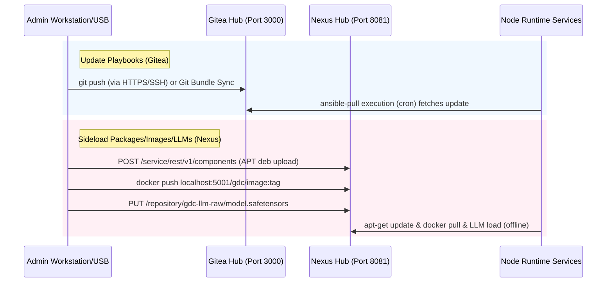

# Specification: GDC Ready-Linux Provisioning & Sideloading Interface

**Spec Identifier:** `GDC-SPEC-003`  
**Status:** DRAFT  
**Author:** GDC Disk Provisioner Architecture Team  

---

## 1. Overview & Purpose
This specification governs the transitioning from a baseline OS install to a "Ready-Linux" node, configuring administrative identities, persistent Gitea & Nexus boundary service hubs, hardware cryptography (TPM 2.0), security hardening, and standard offline update/sideloading procedures.

---

## 2. The First-Boot Migration & Service Transition
During the final moments of Subiquity installation (`late-commands`), the pre-loaded Gitea/Nexus services and data stores are cloned from the read-only live media into the newly configured LVM partitions on the target system.

### 2.1. Late-Command Sync Script
```yaml
autoinstall:
  late-commands:
    # 1. Mount the persistent Gitea and Nexus logical volumes
    - mkdir -p /target/var/lib/gitea /target/var/lib/nexus
    
    # 2. Extract and sync data from CD-ROM to persistent partitions
    - rsync -a --info=progress2 /cdrom/custom-data/gitea/ /target/var/lib/gitea/
    - rsync -a --info=progress2 /cdrom/custom-data/nexus/ /target/var/lib/nexus/
    
    # 3. Deploy persistent systemd configurations
    - cp /cdrom/custom-data/systemd/gitea.service /target/etc/systemd/system/
    - cp /cdrom/custom-data/systemd/nexus.service /target/etc/systemd/system/
    - curtin in-target -- systemctl enable gitea.service nexus.service
```

Upon rebooting, Gitea and Nexus boot as local system-wide processes, ready to serve playbooks, packages, and container images locally on `localhost`.

---

## 3. Ansible-Pull Bootstrap Execution
A first-boot systemd unit (`gdc-provision.service`) runs `ansible-pull` locally to pull and execute the bootstrap configuration completely offline:

```ini
[Unit]
Description=GDC Ready-Linux First Boot Provisioner
After=gitea.service nexus.service network.target
Requires=gitea.service nexus.service

[Service]
Type=oneshot
ExecStart=/usr/bin/ansible-pull \
  -U http://localhost:3000/gdc/bootstrap-playbooks.git \
  -i localhost, \
  local.yml
RemainAfterExit=true

[Install]
WantedBy=multi-user.target
```

---

## 4. Playbook Tasks: Ready-Linux Configuration

### 4.1. Administrative User Setup
* Creates user `gdc-admin`.
* Places passwordless sudo parameters under `/etc/sudoers.d/gdc-admin`:
  ```text
  gdc-admin ALL=(ALL) NOPASSWD:ALL
  ```
* Generates authorized keys mapping passwordless SSH connectivity.

### 4.2. TPM 2.0 Cryptographic Binding
To enforce extreme offline edge security, the node leverages its TPM 2.0 chip:
1. **LUKS Disk Decryption:** Binds the physical storage block (`/dev/nvme0n1p3`) to TPM PCR measurements `0` (firmware), `2` (option ROMs), and `7` (Secure Boot state):
   ```bash
   systemd-cryptenroll --tpm2-device=auto --tpm2-pcrs=0+2+7 /dev/nvme0n1p3
   ```
2. **TPM-Backed SSH Agent:** Instructs OpenSSH host key creation to generate keys stored inside the TPM enclave using `ssh-tpm-agent`.
3. **Device Identity:** Employs step-ca clients to request identity certificates signed by a TPM endorsement key to establish cryptographically verifiable node authentication.

### 4.3. CIS Hardening Implementation
Ansible plays enforce CIS Benchmark Level 2 controls:
* Configures auditd rules to monitor execution behavior, file mounts, and permission alterations.
* Restricts SSH configurations: disables root logins, restricts cipher-suites to FIPS-approved algorithms.
* Adjusts standard sysctl profiles (e.g. `net.ipv4.conf.all.accept_redirects = 0`).

### 4.4. OS Slimming
A task executes to purge legacy packages to limit attack vectors and system footprint:
```bash
apt-get purge -y snapd unattended-upgrades snap-confine x11-common wireless-tools
apt-get autoremove -y --purge
```

---

## 5. The Sideloading Interface (Offline Sync Mechanics)
In offline environments, updates are pushed into the local Gitea/Nexus hubs.



### 5.1. Git Bundle Sideloading (Code Update)
When direct SSH/HTTP network pushing is unavailable, a physical USB containing a Git Bundle is synced:
```bash
# Create bundle on online machine
git bundle create bootstrap-playbooks.bundle main

# Apply bundle on offline machine
git clone bootstrap-playbooks.bundle /tmp/usb-update
cd /tmp/usb-update
git push http://localhost:3000/gdc/bootstrap-playbooks.git main:main
```

### 5.2. REST API Component Sideloading (APT/Docker/LLMs)
The local admin or update scripts can push assets directly to Gitea/Nexus utilizing REST APIs:
```bash
# Sideload APT Deb packages
curl -u admin:password -X POST "http://localhost:8081/service/rest/v1/components?repository=gdc-apt-hosted" \
  -F "apt.asset=@/media/usb/packages/fluent-bit_2.2.0.deb"

# Sideload LLM Hugging Face weights to raw storage
curl -u admin:password -X PUT "http://localhost:8081/repository/gdc-llm-raw/models/gemma-2b.safetensors" \
  --data-binary "@/media/usb/models/gemma-2b.safetensors"
```

Inference and package clients query local endpoints (`HF_ENDPOINT=http://localhost:8081/repository/gdc-llm-raw/`), satisfying dependencies cleanly without outside network requirements.
