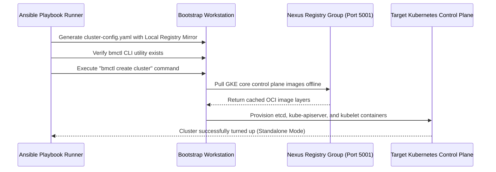

# Specification: GDC Offline Cluster Turnup

**Spec Identifier:** `GDC-SPEC-005-TURNUP`  
**Status:** APPROVED  
**Author:** GDC Disk Provisioner Architecture Team  

---

## 1. Executive Summary & Purpose
This specification details the final bootstrapping stage: **Stage 5: Cluster Turnup**. It defines how to deploy and configure a Google Distributed Cloud (GDC) bare-metal cluster completely offline on our bootstrapped hardware nodes. 

By utilizing our persistent Service Hubs (Gitea and Nexus) as **Bootstrap Dependency Interfaces**, the installation process pulls all system images, configurations, and core Kubernetes components locally on loopback interfaces, guaranteeing a seamless, disconnected turnup.

---

## 2. Prerequisites & Pre-Seeded Caches (Docker Group Repository)
Before initiating cluster turnup, the target node must reside in a fully completed "Ready-Linux" state, validating:
1.  **Service Hubs Operational:** Gitea (port 3000) and Nexus (port 8081) are active, stable, and running on persistent LVM volumes.
2.  **Seeded OCI Registry Group:** A local **Docker Group Repository** (configured as `gdc-docker-group` and exposed on Port `5001`) is initialized in Nexus. This group repository aggregates:
    *   **`gdc-docker-hosted` (Hosted Registry):** A read-write repository populated during ISO compilation. At the time of ISO generation, the build pipeline identifies, pulls, and pushes all required container images—fully versioned with their semantic tags—for:
        *   **Cluster Components:** GKE system core, `kube-apiserver`, `etcd`, `coredns`, and CNI controllers.
        *   **Platform Utilities:** MetalLB, storage controllers (e.g., local-disk provisioner), and telemetry services.
        *   **Applications:** Initial user space microservices and workloads.
    *   **`gdc-docker-proxy` (Proxy Registry):** A read-only upstream registry proxy (pointing to `gcr.io`, `docker.io`, `registry.k8s.io`, etc.) to automatically fetch and cache external containers when internet pass-thru is active.
3.  **Local Playbook Sync:** Gitea holds the validated GDC bare-metal cluster configuration playbooks.

---

## 3. Configuration of the local Registry Mirror & Keyless Profile
To prevent the cluster creation utility (`bmctl`) and target `kubelet` agents from attempting to fetch images from public internet gateways (e.g. `gcr.io` or `pkg.dev`), the `bmctl` cluster configuration YAML must be explicitly redirected to our local Nexus Group Registry loopback port `5001`.

Additionally, the GDC standalone cluster is configured to execute a **"Keyless" (IAM-less) Installation**. By default, GDC Bare Metal installations require provisioning multiple Google Service Accounts (GSAs) and writing their associated private JSON keys on the node filesystem (e.g. for logging, monitoring, and cluster registration). In remote edge environments, storing private credentials on physical hardware represents an unacceptable theft risk. 

By utilizing the GDC **NodeAgent** combined with TPM 2.0-bound host hardware attestation, we eliminate these static JSON keyfiles. The `cluster-config.yaml` is configured with all GSA key paths omitted, ensuring the cluster bootstraps with zero persistent cloud credential leakage risks on-disk.

```yaml
# cluster-config.yaml
apiVersion: baremetal.cluster.gke.io/v1
kind: Cluster
metadata:
  name: gdc-edge-cluster
  namespace: cluster-gdc-edge-cluster
spec:
  type: standalone
  profile: default
  # --- REDIRECT CONTAINER IMAGE REGISTRY MIRRORS OFF-LINE ---
  registryMirror:
    endpoint: http://127.0.0.1:5001
  # --- ENFORCE KEYLESS (GSA-LESS) SECURITY STANDARD ---
  # All gcpServiceAccountSigningKeyPath and credential key paths are omitted.
  # NodeAgent uses TPM-bound identity federation instead of static JSON keys.
  # --- Node Networking ---
  controlPlane:
    nodePoolSpec:
      nodes:
        - address: 127.0.0.1 # Local loopback standalone bootstrap
  loadBalancer:
    mode: bundled
    ports:
      controlPlaneVIP: 10.0.0.200
  storage:
    # CSI Host-Path static block boundaries
    localDiskProvisioner:
      storagePath: /customer/local-disk
```

---

## 4. Operational Run-Sequence (Unattended Turnup)
The first-boot GGD Ansible playbook (`local.yml`) triggers cluster creation headlessly after finalizing local system setup:



### 4.1. The Ansible Creation Task
```yaml
- name: "GDC-TURNUP-001 | Generate bmctl Configuration File"
  ansible.builtin.template:
    src: templates/bmctl-cluster-config.yaml.j2
    dest: /root/bmctl-workspace/gdc-edge-cluster/gdc-edge-cluster.yaml
    owner: root
    group: root
    mode: '0600'

- name: "GDC-TURNUP-002 | Execute bmctl Standalone Cluster Creation (Offline)"
  ansible.builtin.command: bmctl create cluster -c gdc-edge-cluster
  args:
    chdir: /root/bmctl-workspace/
  register: bmctl_result
  changed_when: "'Created cluster' in bmctl_result.stdout"
```

On successful completion, the `bmctl` utility bootstraps etcd, launches the Kubernetes API server, registers control plane nodes, and configures the storage boundary (`/customer/local-disk`). It then writes the cluster's administrative kubeconfig to `/root/bmctl-workspace/gdc-edge-cluster/gdc-edge-cluster-kubeconfig`.

### 4.2. Deploying GDC NodeAgent
Once the GDC cluster is created and operational, we must deploy the GDC NodeAgent daemonset to manage and monitor cluster nodes locally. 

Since the NodeAgent container images were pre-staged in `gdc-docker-hosted` during the Ready-Linux phase, the deployment pulls the images entirely offline via the local registry mirror (`http://127.0.0.1:5001`).

The playbook executes the deployment command (aligned with the [GDC Bare Metal bmctl NodeAgent Deploy Guide](https://docs.cloud.google.com/kubernetes-engine/distributed-cloud/bare-metal/docs/reference/bmctl#nodeagent_deploy)):

```yaml
- name: "GDC-TURNUP-003 | Deploy GDC NodeAgent onto Node Machines"
  ansible.builtin.command: >
    bmctl deploy nodeagent 
    --cluster=gdc-edge-cluster 
    --kubeconfig=/root/bmctl-workspace/gdc-edge-cluster/gdc-edge-cluster-kubeconfig
  args:
    chdir: /root/bmctl-workspace/
  register: nodeagent_result
  changed_when: "'Deployed nodeagent' in nodeagent_result.stdout"
```

The NodeAgent is deployed into the GDC cluster namespace and immediately spawns daemonset pods on the target nodes to monitor system resources, manage OS configurations, and coordinate ongoing system lifecycle activities.
