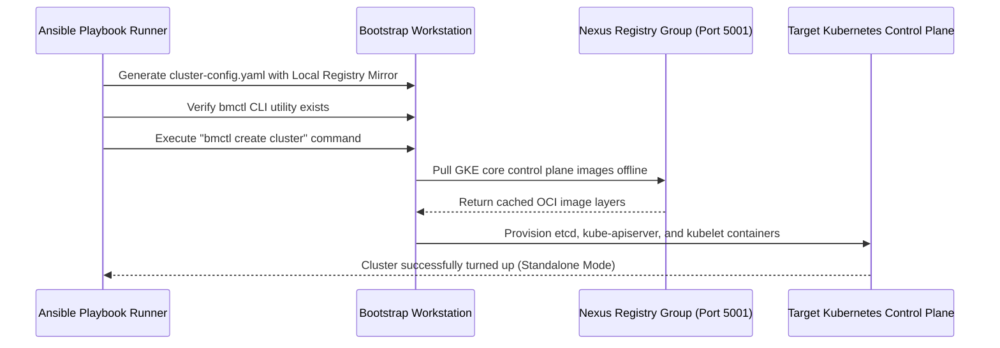

# Specification: GDC Offline Cluster Turnup

**Spec Identifier:** `GDC-SPEC-005-TURNUP`  
**Status:** APPROVED  
**Author:** GDC Disk Provisioner Architecture Team  

---

## 1. Executive Summary & Purpose
This specification details the final bootstrapping stage: **Stage 5: Cluster Turnup**. It defines how to deploy and configure a Google Distributed Cloud (GDC) bare-metal cluster completely offline on our bootstrapped hardware nodes. 

By utilizing our persistent Service Hubs (Gitea and Nexus) as **Bootstrap Dependency Interfaces**, the installation process pulls all system images, configurations, and core Kubernetes components locally on loopback interfaces, guaranteeing a seamless, disconnected turnup.

---

## 2. Prerequisites & Pre-Seeded Caches (Docker Group Repository)
Before initiating cluster turnup, the target node must reside in a fully completed "Ready-Linux" state, validating:
1.  **Service Hubs Operational:** Gitea (port 3000) and Nexus (port 8081) are active, stable, and running on persistent LVM volumes.
2.  **Seeded OCI Registry Group:** A local **Docker Group Repository** (configured as `gdc-docker-group` and exposed on Port `5001`) is initialized in Nexus. This group repository aggregates:
    *   **`gdc-docker-hosted` (Hosted Registry):** A read-write repository populated during ISO compilation. At the time of ISO generation, the build pipeline identifies, pulls, and pushes all required container images—fully versioned with their semantic tags—for:
        *   **Cluster Components:** GKE system core, `kube-apiserver`, `etcd`, `coredns`, and CNI controllers.
        *   **Platform Utilities:** MetalLB, storage controllers (e.g., local-disk provisioner), and telemetry services.
        *   **Applications:** Initial user space microservices and workloads.
    *   **`gdc-docker-proxy` (Proxy Registry):** A read-only upstream registry proxy (pointing to `gcr.io`, `docker.io`, `registry.k8s.io`, etc.) to automatically fetch and cache external containers when internet pass-thru is active.
3.  **Local Playbook Sync:** Gitea holds the validated GDC bare-metal cluster configuration playbooks.

---

## 3. Configuration of the local Registry Mirror & Keyless Profile
To prevent the cluster creation utility (`bmctl`) and target `kubelet` agents from attempting to fetch images from public internet gateways (e.g. `gcr.io` or `pkg.dev`), the `bmctl` cluster configuration YAML must be explicitly redirected to our local Nexus Group Registry loopback port `5001`.

Additionally, the GDC standalone cluster is configured to execute a **"Keyless" (IAM-less) Installation**. By default, GDC Bare Metal installations require provisioning multiple Google Service Accounts (GSAs) and writing their associated private JSON keys on the node filesystem (e.g. for logging, monitoring, and cluster registration). In remote edge environments, storing private credentials on physical hardware represents an unacceptable theft risk. 

By utilizing the GDC **NodeAgent** combined with TPM 2.0-bound host hardware attestation, we eliminate these static JSON keyfiles. The `cluster-config.yaml` is configured with all GSA key paths omitted, ensuring the cluster bootstraps with zero persistent cloud credential leakage risks on-disk.

*(For the consolidated technical architecture and sequence diagrams on TPM 2.0 hardware attestation, EKCert verification, and mTLS certificate provisioning, see [`docs/TPM_ATTESTATION_AND_MTLS.md`](../TPM_ATTESTATION_AND_MTLS.md).)*

```yaml
# cluster-config.yaml
# --- GDC NODEAGENT mTLS SECURITY CREDENTIALS (TOP-LEVEL CONFIG) ---
nodeAgentServerCACertificatePath: bmctl-workspace/gdc-edge-cluster/nodeagent-creds/server_ca_cert.pem
nodeAgentServerCAPrivateKeyPath: bmctl-workspace/gdc-edge-cluster/nodeagent-creds/server_ca_key.pem
nodeAgentClientCACertificatePath: bmctl-workspace/gdc-edge-cluster/nodeagent-creds/client_ca_cert.pem
---
apiVersion: baremetal.cluster.gke.io/v1
kind: Cluster
metadata:
  name: gdc-edge-cluster
  namespace: cluster-gdc-edge-cluster
  annotations:
    # Instructs GDC to deploy and manage the NodeAgent daemon natively
    baremetal.cluster.gke.io/enable-node-agent: ""
spec:
  type: standalone
  profile: default
  # --- REDIRECT CONTAINER IMAGE REGISTRY MIRRORS OFF-LINE ---
  registryMirror:
    endpoint: http://127.0.0.1:5001
  # --- ENFORCE KEYLESS (GSA-LESS) SECURITY STANDARD ---
  # All gcpServiceAccountSigningKeyPath and credential key paths are omitted.
  # NodeAgent uses TPM-bound identity federation instead of static JSON keys.
  # --- Node Networking ---
  controlPlane:
    nodePoolSpec:
      nodes:
        - address: 127.0.0.1 # Local loopback standalone bootstrap
  loadBalancer:
    mode: bundled
    ports:
      controlPlaneVIP: 10.0.0.200
  storage:
    # CSI Host-Path static block boundaries
    localDiskProvisioner:
      storagePath: /customer/local-disk
```

---

## 4. Operational Run-Sequence (Unattended Turnup)
The first-boot GGD Ansible playbook (`local.yml`) triggers cluster creation headlessly after finalizing local system setup:



### 4.1. The Ansible Creation Task
```yaml
- name: "GDC-TURNUP-001 | Generate bmctl Configuration File"
  ansible.builtin.template:
    src: templates/bmctl-cluster-config.yaml.j2
    dest: /root/bmctl-workspace/gdc-edge-cluster/gdc-edge-cluster.yaml
    owner: root
    group: root
    mode: '0600'

- name: "GDC-TURNUP-002 | Execute bmctl Standalone Cluster Creation (Offline)"
  ansible.builtin.command: bmctl create cluster -c gdc-edge-cluster
  args:
    chdir: /root/bmctl-workspace/
  register: bmctl_result
  changed_when: "'Created cluster' in bmctl_result.stdout"
```

On successful completion, the `bmctl` utility bootstraps etcd, launches the Kubernetes API server, registers control plane nodes, and configures the storage boundary (`/customer/local-disk`). It then writes the cluster's administrative kubeconfig to `/root/bmctl-workspace/gdc-edge-cluster/gdc-edge-cluster-kubeconfig`.

### 4.2. Deploying GDC NodeAgent
Once the GDC cluster is created and operational, we must deploy the GDC NodeAgent daemonset to manage and monitor cluster nodes locally. 

Since the NodeAgent container images were pre-staged in `gdc-docker-hosted` during the Ready-Linux phase, the deployment pulls the images entirely offline via the local registry mirror (`http://127.0.0.1:5001`).

The playbook executes the deployment command (aligned with the [GDC Bare Metal bmctl NodeAgent Deploy Guide](https://docs.cloud.google.com/kubernetes-engine/distributed-cloud/bare-metal/docs/reference/bmctl#nodeagent_deploy)):

```yaml
- name: "GDC-TURNUP-003 | Deploy GDC NodeAgent onto Node Machines"
  ansible.builtin.command: >
    bmctl deploy nodeagent 
    --cluster=gdc-edge-cluster 
    --kubeconfig=/root/bmctl-workspace/gdc-edge-cluster/gdc-edge-cluster-kubeconfig
  args:
    chdir: /root/bmctl-workspace/
  register: nodeagent_result
  changed_when: "'Deployed nodeagent' in nodeagent_result.stdout"
```

The NodeAgent is deployed into the GDC cluster namespace and immediately spawns daemonset pods on the target nodes to monitor system resources, manage OS configurations, and coordinate ongoing system lifecycle activities.

### 4.3. Standalone NodeAgent Architecture & mTLS Handshake
You **do not need a separate admin cluster** to leverage NodeAgent. You can absolutely use NodeAgent mode with GDC's **Standalone cluster architecture**.

#### How It Works Together
In Google Distributed Cloud (GDC) bare metal, a **Standalone cluster** is a single, self-contained cluster that handles its own management control plane while simultaneously running your local user workloads.

When you enable NodeAgent mode on a standalone deployment, the internal architecture shifts seamlessly:
1.  **The Internal Controller:** The standalone cluster's own internal control plane hosts GDC's controllers.
2.  **The Local Target:** The `NodeAgent` systemd service is deployed right alongside it on the target bare-metal nodes.
3.  **The Connection:** The standalone cluster's management control plane talks directly to its local `NodeAgent` via a secure, internal **mTLS gRPC** channel on the specified port (defaulting to `9192`).

#### The Tradeoff to Keep in Mind
While a standalone configuration saves significant local hardware resources (perfect for edge setups or compact lab environments), keep in mind that **the local node still needs initial SSH bootstrapping**. The `bmctl` tool running on your deployment workstation will use SSH to push the `NodeAgent` binary and seed the initial mTLS certificates to the standalone node machine. Once that bootstrap phase finishes, the cluster switches completely over to the agent-driven model for its day-to-day configuration updates.

---

## 5. Multi-Node (3-Node) Cluster Coordination Plan

While the baseline GGD architecture is designed to turn up a Single-Node standalone cluster on loopback `127.0.0.1`, production deployments frequently demand high-availability (HA) control planes consisting of **3 or more node machines**. 

When the upstream **machine database** (or local Gitea-synced cluster variables) specifies a multi-node cluster topology, GGD's Ansible-pull and turnup layers dynamically pivot to orchestrate safe, fully offline multi-node coordination.

```
                  [ NODE 1 (Bootstrap / Primary) ]
                  • Gitea & Nexus Active (Registry on 10.0.0.10:5001)
                  • Holds cluster private key & bmctl CLI
                  • Runs 'bmctl create cluster'
                     /                           \
                    /                             \
     (SSH deploy / Pull OCI)               (SSH deploy / Pull OCI)
                  v                                 v
     [ NODE 2 (Secondary CP) ]         [ NODE 3 (Secondary CP) ]
     • Ready-Linux Hardened            • Ready-Linux Hardened
     • Local APT pointed to Nexus      • Local APT pointed to Nexus
     • Registry Mirror: 10.0.0.10      • Registry Mirror: 10.0.0.10
```

### 5.1. Discovery & Role Designation
During the `ready-linux` phase, each node queries the cluster variables database and assigns machine roles dynamically:
*   **Primary Node (Node 1 - Bootstrap):** Acting as the primary control plane node, Node 1 is responsible for hosting Gitea/Nexus service hubs, maintaining GDC system configuration templates, and executing the cluster installation.
*   **Secondary Nodes (Node 2 & Node 3):** These nodes complete their baseline OS installation, execute CIS Level 2 hardening, register GPG keyrings, and wait passively for SSH connection handshakes from Node 1.

### 5.2. Offline SSH Trust & Key Exchange
GDC Bare Metal requires passwordless root SSH access from the bootstrap node to all cluster nodes (including itself) to execute the install. 
1.  **Workstation Generation:** During Phase 1 ISO build, a cluster-scoped deployment SSH keypair is generated and baked securely into Gitea.
2.  **Ready-Linux Provisioning:** 
    *   On **Node 1**, GGD's Ansible playbook writes the private key to `/root/.ssh/id_rsa`.
    *   On **Node 2 & Node 3**, GGD's playbook writes the corresponding public key to `/root/.ssh/authorized_keys`.
3.  **Mutual Node Trust:** This establishes automated, secure SSH access across all three nodes completely offline, satisfying GDC's strict root access pre-requisites.

### 5.3. Multi-Node Registry Mirror & Networking Configuration
Because Node 2 and Node 3 do not run heavy local Nexus image registries (to preserve CPU/RAM), they must retrieve container layers from Node 1's local OCI proxy mirror over the high-speed local network.

1.  **Registry Mirror Hostname Configuration:** In `cluster-config.yaml`, the `registryMirror` endpoint is configured using Node 1's private, static cluster IP (e.g. `10.0.0.10`) instead of localhost:
    ```yaml
    # cluster-config.yaml
    spec:
      registryMirror:
        endpoint: http://10.0.0.10:5001
    ```
2.  **Control Plane IP Allocations:** The cluster configuration dynamically maps out the three node control plane addresses:
    ```yaml
    # cluster-config.yaml
    spec:
      controlPlane:
        nodePoolSpec:
          nodes:
            - address: 10.0.0.10 # Node 1 (Bootstrap)
            - address: 10.0.0.11 # Node 2 (Secondary)
            - address: 10.0.0.12 # Node 3 (Secondary)
    ```

### 5.4. Orchestrated Execution & Fallbacks
The Ansible first-boot playbook on Node 1 manages the multi-node sync flow:
1.  **Reachability Barrier:** Node 1 blocks executing `bmctl` until both Node 2 and Node 3 answer SSH handshakes on port 22 and respond to ICMP pings.
2.  **Preflight Dependencies Execution:**
    *   Node 1 starts Gitea/Nexus.
    *   Node 2 and Node 3 utilize their local APT configs (which point to Node 1's Nexus proxy or local cache) to run `apt-get install` for the pre-requisite GDC system packages (e.g. `socat`, `conntrack`, `iproute2`), with `addPackageRepo: false` ensuring public external keys are ignored.
3.  **HA Cluster Turnup:** Node 1 executes `bmctl create cluster -c gdc-edge-cluster`. The utility connects to all three nodes, pulls control plane container layers from `10.0.0.10:5001` (Nexus OCI proxy/hosted group), and forms a highly available 3-node standalone cluster.
4.  **NodeAgent DaemonSet Deployment:** Once the cluster is fully constructed, the playbook triggers `bmctl deploy nodeagent`, which spawns the NodeAgent daemonset across all 3 nodes to manage ongoing lifecycle and monitoring.

