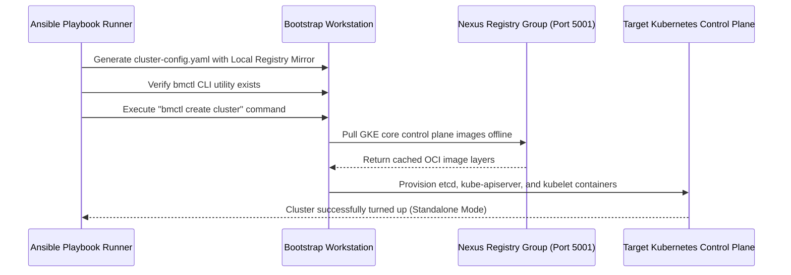

# Specification: GDC Offline Cluster Turnup

**Spec Identifier:** `GDC-SPEC-005-TURNUP`  
**Status:** APPROVED  
**Author:** GDC Disk Provisioner Architecture Team  

---

## 1. Executive Summary & Purpose
This specification details the final bootstrapping stage: **Stage 5: Cluster Turnup**. It defines how to deploy and configure a Google Distributed Cloud (GDC) bare-metal cluster completely offline on our bootstrapped hardware nodes. 

By utilizing our persistent Service Hubs (Gitea and Nexus) as **Bootstrap Dependency Interfaces**, the installation process pulls all system images, configurations, and core Kubernetes components locally on loopback interfaces, guaranteeing a seamless, disconnected turnup.

---

## 2. Prerequisites & Pre-Seeded Caches
Before initiating cluster turnup, the target node must reside in a fully completed "Ready-Linux" state, validating:
1.  **Service Hubs Operational:** Gitea (port 3000) and Nexus (port 8081) are active, stable, and running on persistent LVM volumes.
2.  **Seeded OCI Registry:** The local Nexus OCI registry group (`gdc-docker-group`, port 5001) is populated with GKE system, MetalLB, and storage controller container image layers.
3.  **Local Playbook Sync:** Gitea holds the validated GDC bare-metal cluster configuration playbooks.

---

## 3. Configuration of the local Registry Mirror
To prevent the cluster creation utility (`bmctl`) and target `kubelet` agents from attempting to fetch images from public internet gateways (e.g. `gcr.io` or `pkg.dev`), the `bmctl` cluster configuration YAML must be explicitly redirected to our local Nexus boundary port `5001`.

```yaml
# cluster-config.yaml
apiVersion: baremetal.cluster.gke.io/v1
kind: Cluster
metadata:
  name: gdc-edge-cluster
  namespace: cluster-gdc-edge-cluster
spec:
  type: standalone
  profile: default
  # --- REDIRECT CONTAINER IMAGE REGISTRY MIRRORS OFF-LINE ---
  registryMirror:
    endpoint: http://127.0.0.1:5001
  # --- Node Networking ---
  controlPlane:
    nodePoolSpec:
      nodes:
        - address: 127.0.0.1 # Local loopback standalone bootstrap
  loadBalancer:
    mode: bundled
    ports:
      controlPlaneVIP: 10.0.0.200
  storage:
    # CSI Host-Path static block boundaries
    localDiskProvisioner:
      storagePath: /customer/local-disk
```

---

## 4. Operational Run-Sequence (Unattended Turnup)
The first-boot GGD Ansible playbook (`local.yml`) triggers cluster creation headlessly after finalizing local system setup:



### 4.1. The Ansible Creation Task
```yaml
- name: "GDC-TURNUP-001 | Generate bmctl Configuration File"
  ansible.builtin.template:
    src: templates/bmctl-cluster-config.yaml.j2
    dest: /root/bmctl-workspace/gdc-edge-cluster/gdc-edge-cluster.yaml
    owner: root
    group: root
    mode: '0600'

- name: "GDC-TURNUP-002 | Execute bmctl Standalone Cluster Creation (Offline)"
  ansible.builtin.command: bmctl create cluster -c gdc-edge-cluster
  args:
    chdir: /root/bmctl-workspace/
  register: bmctl_result
  changed_when: "'Created cluster' in bmctl_result.stdout"
```

On successful completion, the `bmctl` utility bootstraps etcd, launches the Kubernetes API server, registers control plane nodes, and configures the storage boundary (`/customer/local-disk`). It then writes the cluster's administrative kubeconfig to `/root/bmctl-workspace/gdc-edge-cluster/gdc-edge-cluster-kubeconfig`.
